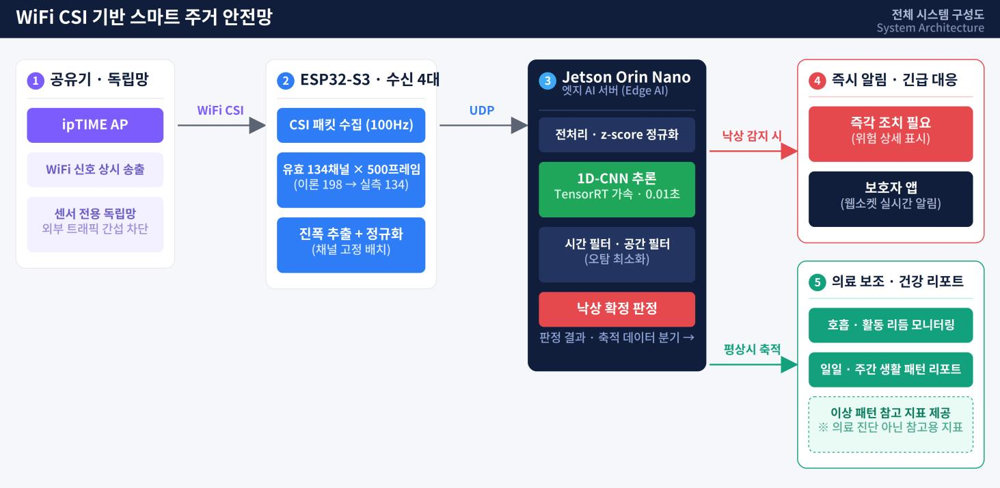
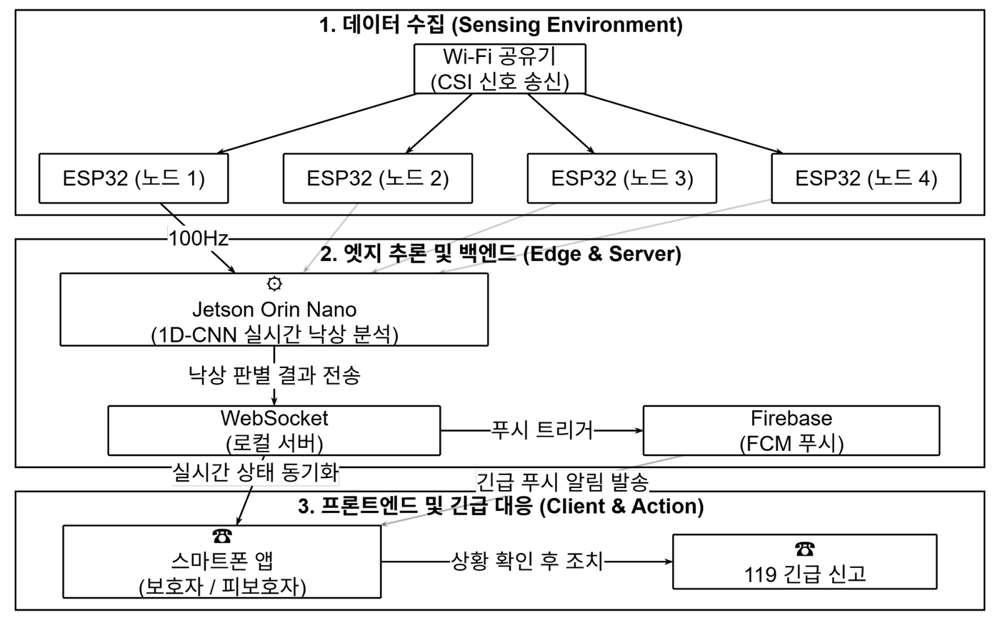
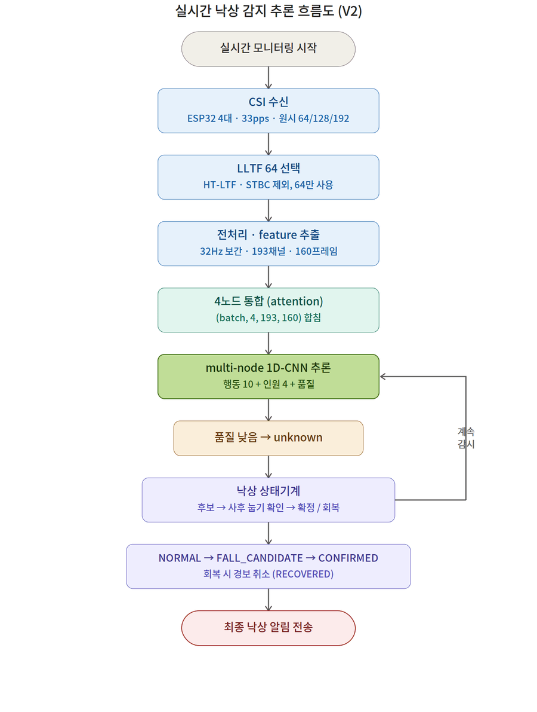

# 📝 WiFi CSI 기반 주거 취약계층을 위한 스마트 주거 안전망

> 2026년 한이음 드림업 공모전 · 카메라도, 웨어러블도 없이 **WiFi 신호만으로** 집 안 낙상을 감지하고 보호자에게 즉시 알리는 비접촉 주거 안전망

<p align="center">
  
</p>

---

## **💡1. 프로젝트 개요**

**1-1. 프로젝트 소개**

- 프로젝트 명 : WiFi CSI 기반 주거 취약계층을 위한 스마트 주거 안전망
- 프로젝트 정의 : WiFi 신호의 채널 상태 정보(CSI, Channel State Information)를 분석해 카메라·웨어러블 없이 실내 낙상을 실시간으로 감지하고, 보호자 앱으로 위험 상황을 즉시 확인·대응할 수 있게 하는 비접촉 스마트 주거 안전망
- 동작 개요
  - **센싱** : ipTIME 공유기가 센서 전용 독립망에서 신호를 송출하고, ESP32-S3 수신 노드 4대가 CSI를 실시간 추출해 UDP로 전송
  - **엣지 AI** : Jetson Orin Nano가 4개 노드의 CSI를 통합해 multi-node 1D-CNN으로 행동·인원·신호 품질을 추론하고, 낙상 상태기계로 오탐을 걸러 낙상을 확정
  - **알림·대응** : Node.js 로컬 서버가 WebSocket으로 앱에 상태를 실시간 동기화하고, 위급 시 FCM 푸시를 발송. 보호자는 집 도면에서 위치를 확인하고 전화·119 신고로 대응

**1-2. 개발 배경 및 필요성**

- **돌봄 공백의 심화** : 65세 이상 1인 가구는 2022년 192.3만 가구에서 2052년 496.1만 가구로 늘어날 전망이며(통계청), 독거노인 비율도 2024년 23.7%로 2000년(16.2%) 대비 크게 증가했습니다. 인력 기반의 상시 돌봄은 한계에 도달해 기술 기반 상시 모니터링이 필요합니다.
- **낙상은 집 안에서 일어난다** : 고령자 안전사고의 62.7%가 낙상이고, 낙상 사고의 51.3%가 주택 내에서 발생합니다. 혼자 사는 고령자에게는 쓰러진 뒤 발견이 늦어지는 것 자체가 가장 큰 위험입니다.
- **기존 방식의 한계** : 카메라는 상시 촬영에 따른 사생활 침해로 설치 거부감이 크고, 웨어러블은 착용 거부·충전 누락 시 감지가 불가능합니다.
- **비접촉 WiFi 센싱의 가능성** : 이미 집에 있는 WiFi 신호의 미세한 왜곡만으로 동작을 인식할 수 있어, 착용·촬영 없이 생활을 방해하지 않는 상시 감지가 가능하고 저가 모듈로 도입 비용도 낮습니다.

**1-3. 프로젝트 특장점**

- **완전 비접촉·비촬영** : 카메라·웨어러블 없이 WiFi CSI만으로 감지하여 사생활 침해와 착용 부담을 원천 제거
- **저비용 하드웨어** : 고가의 WiFi 센싱 전용 NIC 대신 XIAO ESP32-S3 + 오픈소스 RuView 펌웨어로 CSI 추출 노드 구성
- **다중 노드 attention 융합** : 4개 수신 노드의 CSI를 노드별 신호 품질과 함께 attention으로 가중 통합하여, 일부 노드가 끊겨도(node mask) 안정적으로 추론
- **오탐을 줄이는 낙상 상태기계** : 한 번의 확률 튐으로는 알림을 보내지 않고 `낙상 후보 → 사후 눕기 확인 → 확정 / 회복` 단계를 거쳐야만 경보 전송
- **엣지 로컬 처리** : 원시 CSI는 외부로 나가지 않고 Jetson 안에서만 처리되어 프라이버시와 실시간성을 동시에 확보
- **보호자 친화 UI** : 확률·좌표 같은 기술 수치 대신 `정상 / 주의 / 즉각 조치 필요` 3단계 상태와 집 도면 기반 위치로 표현
- **웰니스 범위 준수** : 호흡 리듬 등 생활 데이터는 의료 진단이 아닌 참고 정보로만 제공 (심박 추정은 의도적으로 제외)

**1-4. 주요 기능**

| 구분 | 기능 | 설명 |
|---|---|---|
| H/W | CSI 동시 수신 클러스터 | ipTIME A2004SR 센서 전용 독립망(2.4GHz 고정 채널) + ESP32-S3 수신 노드 4대 + 5dBi 외장 안테나 |
| H/W | 실시간 CSI 전달 | 각 노드가 RuView ADR-018 형식 CSI 패킷을 UDP(5005)로 Jetson에 스트리밍 |
| AI | CSI 특징 추출 | LLTF 64 서브캐리어 선택 → 32Hz 보간 → 로그 진폭·동적 진폭·위상차·RSSI 193채널 × 160프레임(5초) |
| AI | multi-node 1D-CNN | 노드별 1D-CNN 인코더 + attention 융합으로 행동 10종·인원 4분류·신호 품질 동시 추론 |
| AI | 낙상 상태기계 | 반복된 낙상 확률 → 사후 눕기 확인 → 확정(30초 경보 유지) / 회복 시 경보 취소 |
| AI | 호흡 리듬 모니터링 | 정지 상태에서 CSI 진폭 스펙트럼(6~30회/분 대역)으로 분당 호흡수 추정 (참고용) |
| Server | 실시간 상태 동기화 | Node.js 로컬 서버가 `POST /sensor/update`로 엣지 결과를 받아 `WS /ws/location`으로 앱에 전달 |
| Server | 긴급 푸시 | 위험 상황 시 Firebase Cloud Messaging으로 보호자 기기에 푸시 (앱이 꺼져 있어도 수신) |
| App | 역할 기반 화면 | 하나의 앱에서 보호자 모드(위험 대응 중심) / 피보호자 모드(생활 상태·위치 공유 관리) 선택 |
| App | 디지털 트윈 도면 | 집 도면 위에 현재 위치·사람 미니어처·최근 이동 경로 표시, 위치 공유 OFF 시 동선 비공개 |
| App | 위험 대응 | 즉각 조치 알림 → 발생 위치·자세 확인 → 어르신 전화 / 119 신고 정보 / 5단계 상황 대응 절차 |

**1-5. 기대 효과 및 활용 분야**

- 기대 효과
  - 기존 WiFi 인프라와 저가 모듈만으로 상시 낙상 감지가 가능해, 전용 장비 없이 독거노인 돌봄에 바로 적용 가능한 현실적 대안
  - 비접촉·비촬영으로 사생활을 보호하면서 보호자의 원격 확인과 즉시 대응을 지원해 낙상 발견 지연 위험 감소
  - 착용·조작이 필요 없어 스마트 기기 사용이 어려운 고령자도 부담 없이 이용 가능
- 활용 분야
  - 독거노인·취약계층 돌봄 : 가정 내 상시 낙상 감지 및 보호자·복지기관 알림
  - 요양시설·병원 : 다인실·요양실 낙상 자동 감지로 부족한 돌봄 인력 보조
  - 스마트홈 보안 : 외출 시 침입 감지(방범) 모드로 전환해 케어와 방범 겸용
  - 원격 헬스케어 : 축적된 활동·호흡 리듬을 개인 기준선으로 삼아 변화 시 병원 방문을 권유하는 건강관리 보조 (의료 진단 아님)

**1-6. 기술 스택**

- 센서 / H/W : XIAO ESP32-S3 (RuView 펌웨어, 2.4GHz CSI), 2.4GHz 5dBi 다이폴 외장 안테나, ipTIME A2004SR(802.11ac, MU-MIMO), NVIDIA Jetson Orin Nano Super 8GB (JetPack 6.2.1, NVMe SSD)
- 엣지 AI : Python, PyTorch(CUDA), NumPy, UDP 소켓, systemd 서비스
- 서버 : Node.js(HTTP + WebSocket 로컬 서버), Python FastAPI(대안 서버), Firebase Cloud Messaging
- 모바일 앱 : Flutter(Dart), web_socket_channel, firebase_messaging
- 협업 / 관리 : GitHub, Notion, Figma(UI/UX 설계), 카카오톡

---

## **💡2. 팀원 소개(이름 기재X)**

| **멘티1** | **멘티2** | **멘티3** | **멘티4** | **멘토** |
|:---:|:---:|:---:|:---:|:---:|
| • 프로젝트 총괄<br>• H/W 센서망 구축 | • AI 모델 설계·학습<br>• CSI 데이터 수집·라벨링 | • 엣지 추론 파이프라인<br>• Jetson 서버 구축 | • Flutter 앱 UI/UX<br>• 로컬 서버·알림 연동 | • 프로젝트 멘토<br>• 기술 자문 |

---

## **💡3. 시스템 구성도**

**3-1. 서비스 구성도**

데이터 수집(센싱 환경) → 엣지 추론 및 백엔드 → 프론트엔드 및 긴급 대응의 3계층으로 구성됩니다.

<p align="center"></p>

**3-2. 데이터 흐름 (저장소 코드 기준)**

<p align="center"></p>

**3-3. 낙상 감지 AI 추론 흐름도 (V2)**

낙상 여부는 특정 순간의 확률값 하나로 판단하지 않고, 0.5초마다 들어오는 추론 결과를 상태기계로 누적해 순차적으로 확인합니다.

<p align="center"></p>

| 단계 | 조건 (`config/default_config.json`) | 결과 |
|---|---|---|
| ① 낙상 후보 | fall 확률 ≥ 0.70 이 2회 누적 | `NORMAL → FALL_CANDIDATE → POST_FALL_CHECK` |
| ② 사후 확인 | lying(눕기) 확률 ≥ 0.55 가 3회 | `CONFIRMED` · 낙상 확정 알림 전송, 30초간 경보 유지 |
| ③ 회복 체크 | walking/standing/stand_up 확률 ≥ 0.65 가 2회 | `RECOVERED` · 단순히 앉거나 눕는 동작으로 보고 경보 취소 |
| ④ 시간 초과 | 8초 안에 확정·회복 모두 아님 | `NORMAL` 복귀 |
| 예외 | 신호 품질 < 0.55 / 빈 방(인원 0) | `UNKNOWN`으로 판단 유보 / `NORMAL` |

**3-4. H/W 구성도**

<p align="center"></p>

| 구성 | 부품 | 역할 |
|---|---|---|
| 네트워크·송신 | ipTIME A2004SR | 2.4GHz 고정 채널·전용 SSID·노드별 고정 IP로 센서 전용 독립망 구성, 타 기기 트래픽 간섭 차단 |
| 센서 노드 ×4 | XIAO ESP32-S3 + 5dBi 외장 안테나(U.FL→SMA) | RuView 펌웨어로 CSI 추출, 내장 안테나(RSSI -80dBm 수준) 한계를 외장 다이폴로 개선 |
| 엣지 서버 | Jetson Orin Nano Super 8GB | JetPack 6.2.1 + NVMe SSD, GPU 가속 실시간 추론, 원시 CSI 로컬 처리 |
| 설치 환경 | 연구실 · 생활 주거 공간 | 감지 영역 네 모서리에 노드를 분산 배치해 다중 관점(multi-view) CSI 확보 |

**3-5. 앱 메뉴 구성도 및 화면**

<p align="center"></p>

<p align="center"></p>

**3-6. 엔티티 관계도**

<p align="center"></p>

<details>
<summary>유즈케이스 다이어그램 보기</summary>
<p align="center"></p>
</details>

---

## **💡4. 작품 소개영상**

[](https://youtu.be/VIDEO_ID)

**시스템 동작 행동화 (데이터 수집 과정)**

| 앉는 동작 | 눕는 동작 | 넘어지는 동작 |
|:---:|:---:|:---:|
| [](https://www.youtube.com/shorts/iZQwqRPPQ_E) | [](https://www.youtube.com/shorts/-Sp3iTWWZpE) | [](https://www.youtube.com/shorts/3AxhnGbnZMk) |

---

## **💡5. 핵심 소스코드**

**5-1. multi-node 1D-CNN 낙상 감지 모델** — [`edge_ai/hanium_fall_v2/model.py`](edge_ai/hanium_fall_v2/model.py)

- 소스코드 설명 : 4개 노드의 CSI `(batch, 4, 193, 160)`를 노드 공유 1D-CNN 인코더로 각각 임베딩한 뒤, 노드별 신호 품질을 함께 넣은 attention으로 가중 합산합니다. 끊긴 노드는 `node_mask`로 제외되므로 모델 구조를 바꾸지 않고도 수신 노드 수 변화에 대응합니다. 하나의 융합 벡터에서 행동(10종)·인원(0/1/2/3+)·신호 품질을 동시에 출력하며, 전체 약 36만 파라미터의 경량 구조입니다.

```python
class MultiNodeFallModel(nn.Module):
    """Shared node encoder plus activity, person count, and quality heads."""

    def forward(self, features, node_mask, node_quality):
        batch, nodes, channels, frames = features.shape            # (B, 4, 193, 160)
        encoded = self.node_encoder(features.reshape(batch * nodes, channels, frames))
        encoded = encoded.reshape(batch, nodes, self.embedding_dim)

        # 노드 임베딩 + 신호 품질 → attention 점수, 끊긴 노드는 mask로 제외
        quality_column = node_quality.unsqueeze(-1)
        attention_logits = self.attention(torch.cat([encoded, quality_column], dim=-1)).squeeze(-1)
        attention_logits = attention_logits.masked_fill(~node_mask.bool(), -1e4)
        attention_weights = torch.softmax(attention_logits, dim=1)

        fused_embedding = torch.sum(encoded * attention_weights.unsqueeze(-1), dim=1)
        fused_quality = torch.sum(node_quality * attention_weights, dim=1, keepdim=True)
        fused = torch.cat([fused_embedding, fused_quality], dim=1)
        return {
            "activity_logits": self.activity_head(fused),   # 행동 10종
            "count_logits": self.count_head(fused),         # 인원 4분류
            "quality": self.quality_head(fused).squeeze(-1),
            "node_attention": attention_weights,
        }
```

**5-2. 낙상 확정 상태기계** — [`edge_ai/hanium_fall_v2/fall_state.py`](edge_ai/hanium_fall_v2/fall_state.py)

- 소스코드 설명 : 낙상 후보로 등록된 뒤에도 바로 알림을 보내지 않고, 이후 계속 누워 있는지(눕기 확률 누적)와 다시 일어났는지(서기·걷기 확률 누적)를 비교합니다. 회복이 먼저 확인되면 경보를 취소하고, 눕기가 지속될 때만 `CONFIRMED`로 전이해 보호자 알림을 보냅니다. "넘어짐 + 계속 누워있음 + 안 일어남" 세 조건을 모두 만족해야 경보가 울리는 구조입니다.

```python
elif self.state == FallState.NORMAL:
    if fall_probability >= self.config.fall_candidate_probability:      # 0.70
        self.candidate_hits += 1
    else:
        self.candidate_hits = max(0, self.candidate_hits - 1)
    if self.candidate_hits >= self.config.fall_candidate_hits:          # 2회
        self._transition(FallState.FALL_CANDIDATE, now)
        reason = "repeated_fall_probability"
elif self.state == FallState.FALL_CANDIDATE:
    self._transition(FallState.POST_FALL_CHECK, now)
    reason = "checking_post_fall_posture"
elif self.state == FallState.POST_FALL_CHECK:
    if lying_probability >= self.config.post_fall_lying_probability:    # 0.55
        self.lying_hits += 1
    if recovery_probability >= self.config.recovery_probability:        # 0.65
        self.recovery_hits += 1
    else:
        self.recovery_hits = max(0, self.recovery_hits - 1)
    if self.recovery_hits >= self.config.recovery_hits:                 # 일어남 → 경보 취소
        self._transition(FallState.RECOVERED, now)
        reason = "person_recovered"
    elif self.lying_hits >= self.config.post_fall_lying_hits:           # 계속 누움 → 확정
        self._transition(FallState.CONFIRMED, now)
        reason = "fall_then_lying_confirmed"
    elif now - self.state_started >= self.config.post_fall_timeout_seconds:
        self._transition(FallState.NORMAL, now)
        reason = "post_fall_not_confirmed"
```

**5-3. CSI 특징 추출 파이프라인** — [`edge_ai/hanium_fall_v2/features.py`](edge_ai/hanium_fall_v2/features.py)

- 소스코드 설명 : 노드마다 불규칙하게 들어오는 CSI 패킷(약 33pps)을 32Hz 고정 격자로 보간한 뒤, 64개 서브캐리어에서 ① 절대 로그 진폭 ② 중앙값·MAD 기준 동적 진폭 ③ 프레임 간 위상차 ④ RSSI를 뽑아 193채널을 만듭니다. 학습과 실시간 추론이 이 함수 하나를 공유해 두 환경의 입력이 어긋나지 않도록 했습니다.

```python
log_amplitude = np.log1p(np.abs(complex_csi)).astype(np.float32)
absolute_amplitude = np.clip((log_amplitude - 3.0) / 1.5, -3.0, 3.0)

# 환경마다 다른 기본 신호 세기를 지우고 '움직임에 의한 변화'만 남김
median = np.median(log_amplitude, axis=0, keepdims=True)
mad = np.median(np.abs(log_amplitude - median), axis=0, keepdims=True)
dynamic_amplitude = np.clip((log_amplitude - median) / (1.4826 * mad + 0.05), -5.0, 5.0)

# 인접 프레임 간 위상 변화 (낙상처럼 빠른 반사 경로 변화에 민감)
phase_delta = np.zeros_like(log_amplitude, dtype=np.float32)
phase_delta[1:] = np.angle(complex_csi[1:] * np.conj(complex_csi[:-1])) / np.pi

features = np.concatenate(
    [absolute_amplitude.T, dynamic_amplitude.T, phase_delta.T, rssi.T], axis=0
)  # (64 + 64 + 64 + 1 = 193, 160 frames)
```

---

## **💡6. 저장소 구조**

기존에 따로 관리하던 두 저장소(`Hanium_jetson`, `Hanium_app`)를 커밋 이력을 보존한 채 하나로 합쳤습니다.

```text
.
├── README.md
├── docs/
│   ├── images/                  # README 구성도·화면·실물 사진
│   └── data_collection/         # 실환경 CSI 녹화 세션 기록 (36개 녹화, 익명화)
├── edge_ai/                     # (구 Hanium_jetson) Jetson 엣지 AI 파이프라인
│   ├── hanium_fall_v2/          #   특징 추출·모델·학습·낙상 상태기계·호흡/기침 모니터링
│   │   ├── adr018.py            #     RuView ADR-018 CSI 패킷 파서
│   │   ├── features.py          #     193채널 × 160프레임 특징 추출
│   │   ├── model.py             #     multi-node 1D-CNN
│   │   ├── fall_state.py        #     낙상 확정 상태기계
│   │   ├── live_inference.py    #     실시간 UDP 수신 + 추론
│   │   ├── capture_labeled.py   #     라벨링된 CSI 수집
│   │   ├── train.py / evaluate.py
│   │   └── status_api.py        #     추론 결과 HTTP API
│   ├── config/default_config.json
│   ├── jetson/                  #   systemd 서비스·실행 스크립트
│   └── tests/
└── app/                         # (구 Hanium_app) 모바일 앱 + 로컬 서버
    ├── lib/                     #   Flutter 앱 (보호자/피보호자 모드, 도면, 알림)
    ├── server/                  #   Node.js 로컬 서버, FastAPI 대안 서버, Jetson 연동 클라이언트
    └── docs/
```

---

## **💡7. 실행 방법**

**① 엣지 AI (Jetson Orin Nano)**

```bash
cd edge_ai
pip install -r requirements.txt          # + JetPack에 맞는 PyTorch
python3 -m hanium_fall_v2.selftest       # 파이프라인 자체 점검

# 실시간 추론 (ESP32 노드 1~4에서 UDP 5005로 수신)
RUVIEW_APP_DIR=$(pwd) \
RUVIEW_CHECKPOINT=$(pwd)/models/production/best_model.pt \
./jetson/run_live.sh

# 상태 API (기본 :8080) / systemd 서비스 등록
RUVIEW_APP_DIR=$(pwd) ./jetson/run_api.sh
./jetson/install_services.sh "$(pwd)"
```

> 학습된 체크포인트(`*.pt`)와 수집 데이터(`captures/`)는 용량 문제로 저장소에 포함하지 않습니다.

**② 로컬 서버 (노트북 / 발표 PC)**

```powershell
cd app\server
$env:REAL_SENSOR_ONLY="true"                                   # 실제 센서 값만 반영
$env:GOOGLE_APPLICATION_CREDENTIALS="<firebase-service-account.json 경로>"   # FCM 사용 시
.\run_mock_server_node.cmd                                     # http://127.0.0.1:8000/admin
```

Jetson에서 서버로 결과 전달:

```bash
python3 app/server/jetson_edge_client.py --server-url http://<서버 IP>:8000 health
```

**③ Flutter 앱**

```bash
cd app
flutter pub get
flutter run --dart-define=SERVER_URL=http://<서버 IP>:8000 --dart-define=DEMO_MODE=false
```

> Android 에뮬레이터는 기본값 `http://10.0.2.2:8000`으로 PC 서버에 접속합니다.

---

## **💡8. 검증 결과**

- **재현율(Recall) 최우선 설계** : 낙상을 놓치는 것(미탐)이 곧 인명 피해로 이어지므로 정확도 대신 재현율을 1차 지표로 삼고, 클래스 가중 교차 엔트로피로 소수 클래스인 낙상 학습을 강화했습니다.
- **실환경 데이터 수집** : 2026년 7월 4차례에 걸쳐 CSI와 웹캠 관절 좌표를 동시에 녹화했습니다(총 36개 녹화: 낙상 14 · 비틀거리기·물건 줍기 등 혼동 동작 7 · 일상 동작 15). 세션별 목록은 [`docs/data_collection`](docs/data_collection)에 있습니다.
- **실환경 검증 (개발보고서 기준)**
  - 초기 검증 : 502개 클립, 낙상/비낙상 2종 → 재현율 1.0, 오탐 0건
  - 확장 검증 : 1,019개 클립(낙상 302건 포함), 휘청임·물건 줍기 등 헷갈리는 동작을 포함한 11종 라벨 → **재현율 0.933**, 낙상과 가장 혼동되기 쉬운 '휘청임(넘어지지 않음)'을 낙상으로 오탐한 사례 **0건**
- **모델 발전 과정** : 초기 V1은 100Hz로 수집한 유효 134채널 × 500프레임(5초) 입력의 1D-CNN(약 8.7만 파라미터, TensorRT 변환)으로 낙상/비낙상 2종을 분류했습니다. 현재 저장소의 V2는 4노드 attention 융합과 낙상 상태기계를 도입해 행동 10종·인원·신호 품질까지 함께 판단하도록 확장했습니다.

---

## **💡9. 개발 과정의 문제와 해결**

| 문제 | 해결 |
|---|---|
| 노드마다 CSI 패킷의 서브캐리어 수가 64/128/192로 섞여 들어와 학습 데이터와 실시간 입력의 형태가 달라짐 | 64/128/192 길이 패킷이 LLTF·HT-LTF·STBC-HT-LTF 블록 순서로 이어져 있음을 확인하고, 첫 번째 LLTF 블록(64 서브캐리어)만 고정 선택·20MHz 외 프레임은 거부하도록 파서를 표준화 |
| 하드웨어·AI 담당 간 CSI 데이터 형식(채널 수·프레임 길이·라벨)이 통일되지 않음 | 데이터 규격을 명문화하고, 학습·실시간 추론이 하나의 특징 추출 함수를 공유하도록 구조화 |
| 내장 PCB 안테나의 낮은 수신 감도(RSSI -80dBm 수준)로 패킷 유실 발생 | 5dBi 외장 다이폴 안테나 결선으로 SNR 확보 |
| 일반 가정망 트래픽이 CSI에 잡음으로 유입 | 고정 채널·전용 SSID·고정 IP의 센서 전용 독립망 구성 |
| 앱 화면에 서버·센서 상태 등 개발자 중심 정보가 과도하게 노출 | 보호자(위험 대응)·피보호자(생활 상태·위치 공유)로 화면 목적을 재정의 |
| 좌표 기반 위치 표시는 보호자가 이해하기 어려움 | 거실·침실·욕실·현관 등 생활 공간 단위의 디지털 트윈 도면으로 표현 |

---

> ⚠️ **안전 고지 (Wellness)** : 본 서비스는 의료기기가 아니며 질병의 진단·치료를 대체하지 않습니다. 호흡 리듬 등 생활 데이터는 건강 관리 참고용 정보로만 제공됩니다.
