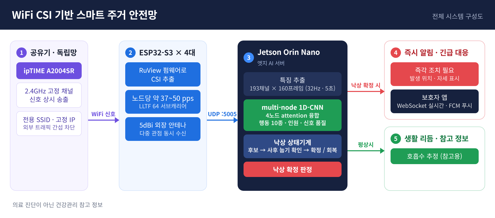
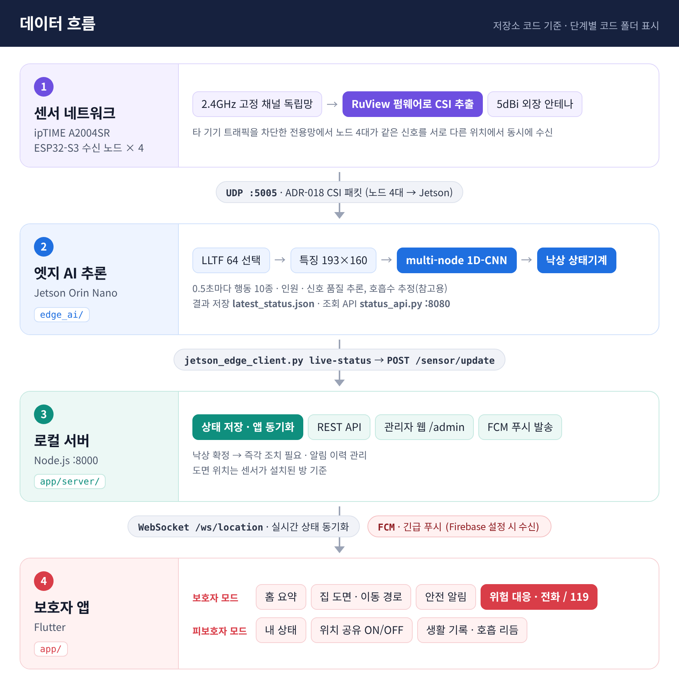
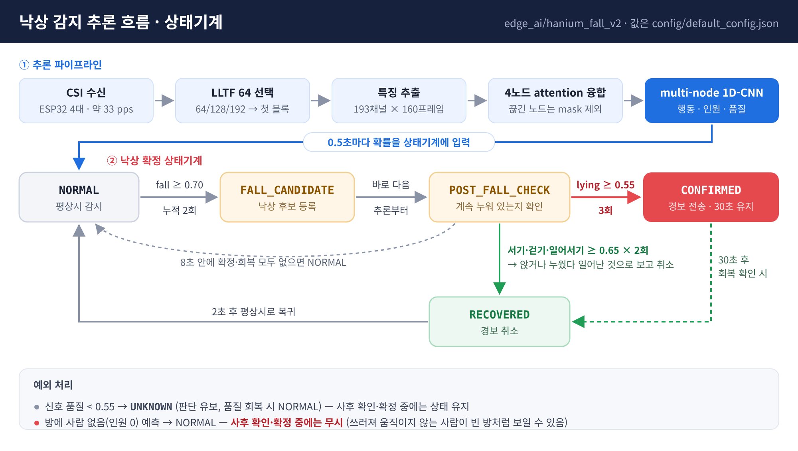
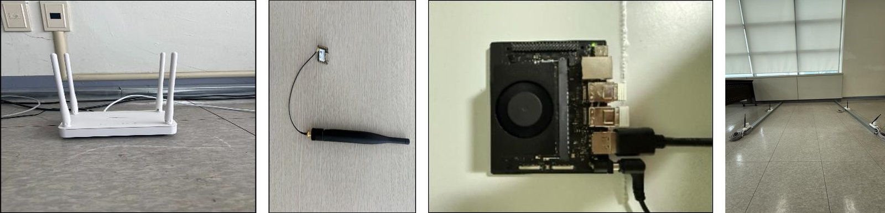
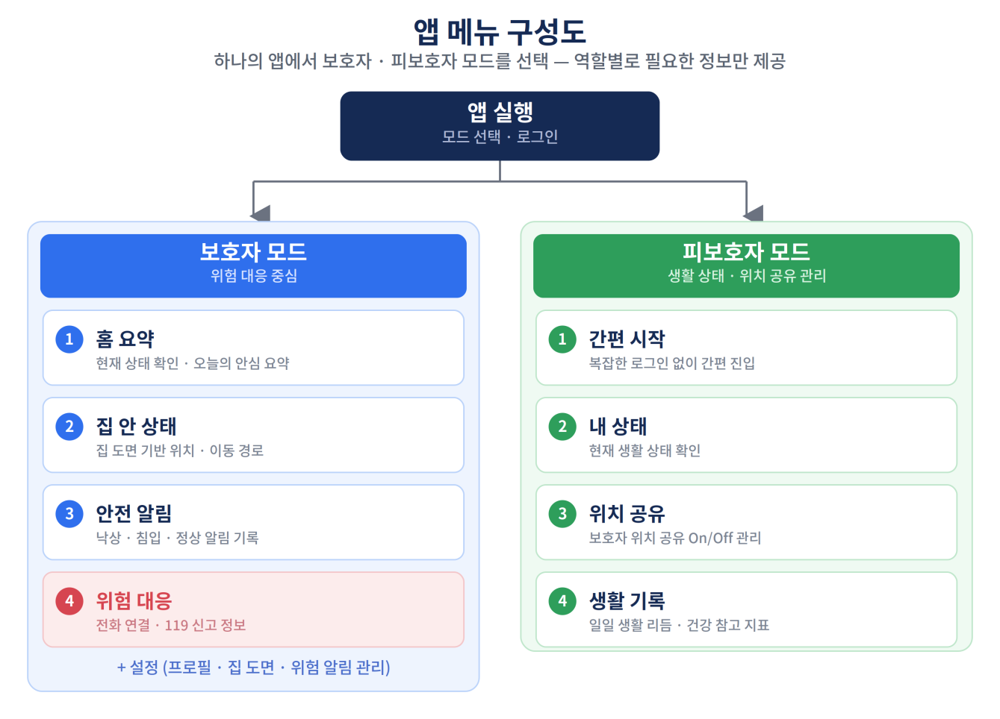
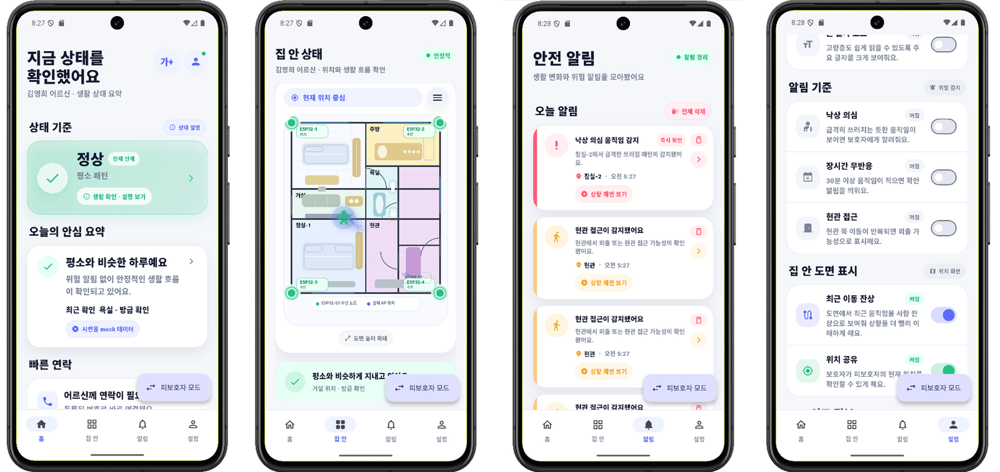
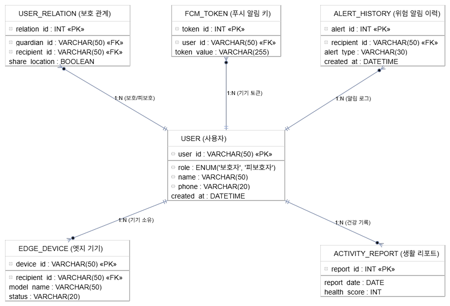
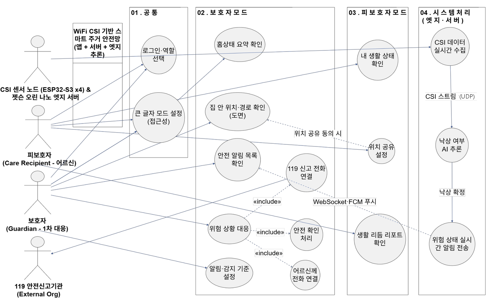
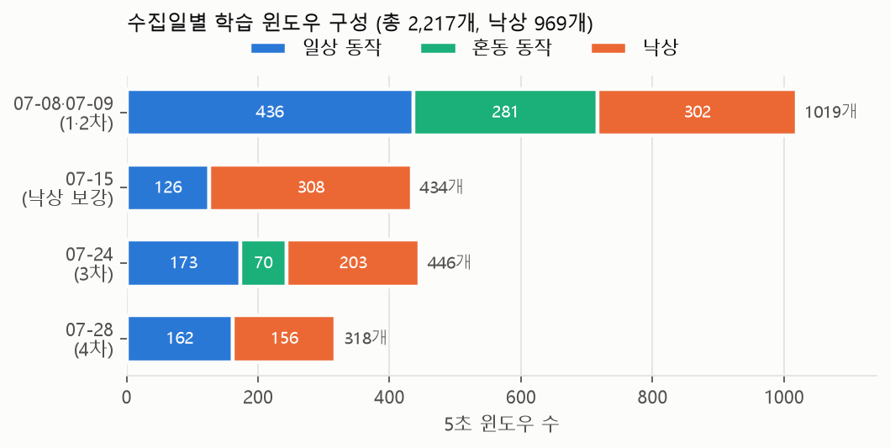
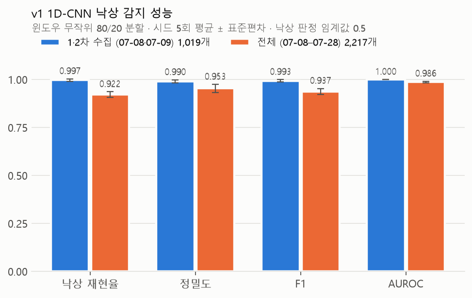

# WiFi CSI 기반 주거 취약계층을 위한 스마트 주거 안전망

> 2026년 한이음 드림업 공모전 · 프로젝트 번호 26_HS022<br>
> 카메라도 웨어러블도 없이 **WiFi 신호(CSI)만으로** 집 안 낙상을 감지하는 것을 목표로, 센서망·엣지 AI·로컬 서버·보호자 앱을 직접 구축하고 실측 데이터셋과 검증 결과까지 공개한 비접촉 주거 안전망

| 한눈에 보기 | |
|---|---|
| **작품 소개영상** | [YouTube에서 보기](https://www.youtube.com/watch?v=05OW0u8NRQg) (4장) |
| **무엇을** | ESP32-S3 4대가 받은 WiFi CSI를 Jetson Orin Nano가 분석해 낙상을 판정하고, 보호자 앱에 실시간 알림·위치·대응 화면을 제공 |
| **공개 자료** | 직접 수집한 [실측 CSI 데이터셋](dataset) (윈도우 2,217개·원본 녹화 4시간) · v1 팀 학습 가중치 2개 · 학습/평가 코드 · Flutter 앱 · 로컬 서버 |
| **코드** | [`edge_ai/`](edge_ai) 엣지 AI(v1 1D-CNN 모델, 실시간 파이프라인 v2) · [`app/`](app) 보호자 앱과 로컬 서버 · [`dataset/`](dataset) 데이터 도구 |
| **학습 결과** | 1·2차 수집 1,019개 윈도우에서 낙상 재현율 0.997·AUROC 1.000, 전체 2,217개 윈도우에서 재현율 0.922·AUROC 0.986 (윈도우 무작위 80/20, 5회 평균). 비틀거리기 동작 오탐 0건 (7장) |
| **문서** | [문서 안내](docs/INDEX.md) · [실행 안내](docs/RUNBOOK.md) · [기능별 구현 현황](docs/IMPLEMENTATION_STATUS.md) |

---

## **💡1. 프로젝트 개요**

**1-1. 프로젝트 소개**

- 프로젝트 명 : WiFi CSI 기반 주거 취약계층을 위한 스마트 주거 안전망
- 프로젝트 정의 : WiFi 신호의 채널 상태 정보(CSI, Channel State Information)를 분석해 카메라·웨어러블 없이 실내 낙상을 감지하고, 보호자 앱으로 위험 상황을 즉시 확인·대응할 수 있게 하는 비접촉 스마트 주거 안전망
- 동작 개요
  - **센싱** : 센서 전용 공유기가 2.4GHz 고정 채널로 신호를 내보내고, ESP32-S3 수신 노드 4대가 패킷마다 CSI를 뽑아 UDP로 전송
  - **엣지 AI** : Jetson Orin Nano가 4개 노드의 CSI를 분석해 낙상 확률을 계산하고, 낙상 상태기계로 순간적인 오판을 걸러 낙상을 확정. 1D-CNN 낙상 분류 모델(v1)은 팀 학습 가중치와 함께, 실시간 서비스용 다중 노드 모델(v2)은 구조·학습 코드로 공개
  - **알림·대응** : 로컬 서버가 WebSocket으로 앱 화면을 실시간 갱신하고 위급 시 FCM 푸시를 발송. 보호자는 집 도면에서 위치를 확인하고 전화·119 신고로 대응

**1-2. 개발 배경 및 필요성**

- **늘어나는 돌봄 공백** : 65세 이상 1인 가구는 2022년 192.3만 가구에서 2052년 496.1만 가구로 늘 것으로 전망됩니다(통계청 장래가구추계). 혼자 사는 고령자가 넘어지면 스스로 도움을 요청하기 어려워 발견이 늦어집니다.
- **기존 방식의 한계** : 카메라는 상시 촬영에 따른 사생활 침해로 설치 거부감이 크고, 웨어러블은 착용 거부·충전 누락 시 감지할 수 없습니다.
- **비접촉 WiFi 센싱** : 사람이 움직이면 실내에서 반사되는 WiFi 신호가 달라지고, 그 변화가 CSI에 남습니다. 착용·촬영 없이 생활을 방해하지 않는 상시 감지가 가능하며, 저가 모듈로 구성할 수 있습니다.

**1-3. 프로젝트 특장점**

- **비접촉·비촬영** : 운영 중에는 카메라·웨어러블 없이 WiFi CSI만 사용합니다. 웹캠은 학습 데이터의 정답 기록에만 썼고, 영상은 저장하지 않았습니다.
- **저비용 하드웨어** : WiFi 센싱 전용 NIC 대신 XIAO ESP32-S3와 오픈소스 [RuView](https://github.com/ruvnet/RuView) 펌웨어로 CSI 수신 노드를 만들었습니다.
- **직접 구축한 실측 데이터셋 공개** : 3주(07-08–07-28)에 걸쳐 5회 수집한 녹화 48건(4시간)의 원본 CSI·관절 좌표와, 그중 45건에서 만든 학습 윈도우 2,217개를 공개합니다. 원본 녹화에서 윈도우를 다시 만들어 팀 학습 파일과 모든 값이 같은지 확인하고, 윈도우마다 출처(녹화·순번·시각)를 기록했습니다.
- **재현 가능한 학습·평가** : 데이터 내려받기부터 학습·평가·결과 그림까지 명령 몇 줄로 다시 실행할 수 있으며, 결과마다 학습 환경과 입력 데이터 해시를 함께 기록합니다.
- **오탐을 줄이는 낙상 상태기계** : 확률이 한 번 튀었다고 알리지 않고 `낙상 후보 → 사후 눕기 확인 → 확정 / 회복` 단계를 거칩니다.
- **보호자 친화 UI** : 확률·좌표 대신 `정상 / 주의 / 위험(즉각 조치 필요)` 상태와 집 도면 위치로 보여 주고, 판단할 수 없을 때는 정상으로 꾸미지 않고 `확인 필요`로 표시합니다.
- **웰니스 범위 준수** : 호흡 리듬은 의료 진단이 아닌 참고 정보로만 제공하며, 심박 추정은 의도적으로 넣지 않았습니다.

**1-4. 주요 기능**

| 구분 | 기능 | 설명 |
|---|---|---|
| H/W | CSI 동시 수신 클러스터 | ipTIME A2004SR 센서 전용망(2.4GHz 6번 채널 고정) + ESP32-S3 노드 4대 + 5dBi 외장 안테나 |
| H/W | 실시간 CSI 전달 | 각 노드가 RuView ADR-018 형식 CSI 패킷을 UDP 5005로 전송 (노드 4대 합계 초당 약 100–200개) |
| Data | 실측 데이터 수집 | CSI와 웹캠 관절 좌표를 함께 기록하고 시각으로 맞춰 500패킷(약 5초) 학습 윈도우 생성 |
| AI | v1 1D-CNN 낙상 분류 | 134채널 × 500패킷(약 5초)을 3단 1D-CNN으로 낙상/비낙상 분류. 팀 학습 가중치·실시간 추론·녹화 재생 시연 포함 |
| AI | v2 다중 노드 모델 (실시간 서비스용) | 노드별 첫 LLTF 64개 서브캐리어 → 32Hz 보간 → 193채널 × 160프레임, 노드 attention 융합으로 행동 10종·인원·신호 품질 추론. 구조·학습 코드 공개 |
| AI | 낙상 상태기계 | 반복된 낙상 확률 → 사후 눕기 확인 → 확정(최소 30초 유지) / 확정 전 회복 시 경보 취소 |
| AI | 호흡 리듬 (참고용) | 정지 상태에서 CSI 로그 진폭과 인접 서브캐리어 위상차의 스펙트럼(분당 6~30회 대역)으로 호흡수 추정 |
| Server | 엣지 → 서버 연동 | `jetson_edge_client.py live-status`가 엣지 판정을 서버 형식으로 바꿔 `POST /sensor/update`로 전달 |
| Server | 실시간 동기화 · 긴급 푸시 | WebSocket 상태 전달, Firebase 설정 시 FCM 푸시, 선택적 API 토큰 |
| App | 역할 기반 화면 | 한 앱에서 보호자 모드(위험 대응) / 피보호자 모드(생활 상태·위치 공유 관리) 선택 |
| App | 집 도면 위치 표시 | 감시 중인 방의 위치·상태를 도면에 표시, 위치 공유 OFF 시 비공개 (이동 경로·현관 접근 알림은 시연 입력으로 제공) |
| App | 위험 대응 | 즉각 조치 알림 → 발생 위치·자세 확인 → 어르신 전화 / 119 신고 정보 / 5단계 대응 절차 |

**1-5. 기대 효과 및 활용 분야**

- 기대 효과
  - 카메라 없이 상시 감지해 독거노인의 사생활을 지키면서 낙상 발견 지연을 줄임
  - 착용·조작이 필요 없어 스마트 기기 사용이 어려운 고령자도 부담 없이 이용
  - 공유기·저가 노드 기반으로 설치 비용 절감
- 활용 분야
  - 독거노인·취약계층 돌봄 : 가정 내 낙상 감지 및 보호자·복지기관 알림
  - 요양시설·병원 : 다인 환경 평가 후 돌봄 인력 보조로 확장
  - 스마트홈 : 외출·침입 감지, 생활 리듬 기록으로 확장

**1-6. 기술 스택**

- 센서 / H/W : XIAO ESP32-S3 (RuView 펌웨어), 2.4GHz 5dBi 다이폴 안테나, ipTIME A2004SR, NVIDIA Jetson Orin Nano Super 8GB (JetPack 6.2.1, NVMe SSD)
- 엣지 AI : Python, PyTorch, NumPy, UDP 소켓, systemd
- 서버 : Node.js (HTTP + WebSocket), Firebase Cloud Messaging
- 모바일 앱 : Flutter (Dart), web_socket_channel, firebase_messaging
- 협업 : GitHub, Notion, Figma, 카카오톡

---

## **💡2. 팀원 소개**

| **멘티1** | **멘티2** | **멘티3** | **멘티4** | **멘토** |
|:---:|:---:|:---:|:---:|:---:|
| • 프로젝트 총괄<br>• H/W 센서망 구축 | • AI 모델 설계·학습<br>• CSI 데이터 수집·라벨링 | • 엣지 추론 파이프라인<br>• Jetson 서버 구축 | • Flutter 앱 UI/UX<br>• 로컬 서버·알림 연동 | • 프로젝트 멘토<br>• 기술 자문 |

---

## **💡3. 시스템 구성도**

**3-1. 전체 시스템 구성도**

<p align="center"></p>

그림은 실시간 서비스용 v2 파이프라인 기준이며, 함께 공개한 학습 가중치는 v1 1D-CNN 모델입니다.

**3-2. 데이터 흐름 (코드 기준)**

각 단계에 해당 코드 폴더를 표시했습니다.

<p align="center"></p>

도면 위치는 센서를 설치한 방을 기준으로 표시합니다. FCM 푸시는 Firebase 프로젝트 설정과 기기 토큰이 있을 때 동작합니다.

**3-3. 낙상 판정 흐름 (상태기계)**

낙상은 한 번의 확률값으로 판단하지 않습니다. 0.5초마다 나오는 추론 결과를 상태기계가 순서대로 확인합니다. 단발성 확률 상승·회복·빈 방 예측 등 10개 시나리오를 합성 입력으로 검사해 모두 의도대로 동작함을 확인했습니다([검증 결과](experiments/RESULTS.md)).

<p align="center"></p>

| 단계 | 조건 ([`default_config.json`](edge_ai/config/default_config.json)) | 결과 |
|---|---|---|
| ① 낙상 후보 | 낙상 확률 ≥ 0.70이 2회 누적 | `NORMAL → FALL_CANDIDATE → POST_FALL_CHECK` |
| ② 사후 확인 | 누워 있음 확률 ≥ 0.55가 3회 누적 | `CONFIRMED` (최소 30초 유지 후 회복 조건 확인) |
| ③ 회복 확인 | 서기·걷기·일어서기 확률 ≥ 0.65가 2회 | `RECOVERED` — 앉거나 누웠다 일어난 것으로 보고 경보 취소 |
| ④ 시간 초과 | 8초 안에 확정·회복 모두 없음 | `NORMAL` 복귀 |
| 예외 | 신호 품질 < 0.55 / 방에 사람 없음 예측 | 판단 보류 / `NORMAL` — 단, 사후 확인·확정 중에는 상태 유지 |

**3-4. H/W 구성 (실물)**

<p align="center"></p>

| 구성 | 부품 | 역할 |
|---|---|---|
| ① 네트워크·송신 | ipTIME A2004SR | 2.4GHz 고정 채널·전용 SSID·노드별 고정 IP로 센서 전용망 구성, 다른 기기 트래픽 간섭 차단 |
| ② 센서 노드 ×4 | XIAO ESP32-S3 + 5dBi 외장 안테나(U.FL→SMA) | RuView 펌웨어로 CSI 추출. 내장 안테나의 낮은 수신 감도(RSSI 약 -80dBm)를 외장 다이폴로 개선 |
| ③ 엣지 서버 | Jetson Orin Nano Super 8GB | JetPack 6.2.1 + NVMe SSD, GPU 추론, 원시 CSI는 기기 안에서만 처리 |
| ④ 설치 | 감지 영역 네 모서리 | 서로 다른 위치의 노드 4대가 같은 신호를 동시에 받아 여러 방향의 CSI 확보 |

**3-5. 앱 메뉴 구성도 및 화면**

<p align="center"></p>

<p align="center"></p>

위 화면은 센서 없이 시연 입력으로 띄운 화면입니다. 실제 센서를 연결하면 감시 중인 방의 상태를 표시하고, 판단할 수 없는 상태는 `확인 필요`, 호흡값이 없으면 `측정 대기`로 보여 줍니다.

<details>
<summary>엔티티 관계도·유즈케이스 다이어그램 보기</summary>

<p align="center"></p>
<p align="center"></p>
</details>

---

## **💡4. 작품 소개영상**

**4-1. 작품 소개영상**

[](https://www.youtube.com/watch?v=05OW0u8NRQg)

1분 32초 분량의 공식 작품 소개영상입니다.

**4-2. 실환경 데이터 수집 장면**

| 앉는 동작 | 눕는 동작 | 넘어지는 동작 |
|:---:|:---:|:---:|
| [](https://www.youtube.com/shorts/iZQwqRPPQ_E) | [](https://www.youtube.com/shorts/-Sp3iTWWZpE) | [](https://www.youtube.com/shorts/3AxhnGbnZMk) |

수집 과정을 보여 주려고 따로 촬영한 참고 영상입니다. 데이터셋에는 영상이 없고, 학습용 웹캠은 프레임을 저장하지 않고 관절 좌표만 기록했습니다.

---

## **💡5. 핵심 소스코드**

**5-1. v1 1D-CNN 낙상 분류기** — [`edge_ai/hanium_fall_v1/model.py`](edge_ai/hanium_fall_v1/model.py), [`train.py`](edge_ai/hanium_fall_v1/train.py)

- 소스코드 설명 : 134채널 × 500패킷(약 5초) CSI를 3단 1D 합성곱(채널 32→64→128, 커널 7→5→3)으로 요약해 낙상/비낙상을 분류합니다. 낙상을 놓치는 비용이 크므로 학습에서 클래스 빈도의 역수로 가중한 교차 엔트로피를 씁니다. 팀이 학습한 가중치 2개를 [`weights/`](edge_ai/hanium_fall_v1/weights)에 함께 공개했습니다.

```python
class CSI1DCNN(nn.Module):
    """Input (batch, 134, 500) -> logits (batch, 2)."""

    def __init__(self, in_channels: int = IN_CHANNELS, num_classes: int = 2, width: int = 32):
        super().__init__()
        self.features = nn.Sequential(
            nn.Conv1d(in_channels, width, 7, padding=3),
            nn.BatchNorm1d(width), nn.ReLU(), nn.MaxPool1d(2),
            nn.Conv1d(width, width * 2, 5, padding=2),
            nn.BatchNorm1d(width * 2), nn.ReLU(), nn.MaxPool1d(2),
            nn.Conv1d(width * 2, width * 4, 3, padding=1),
            nn.BatchNorm1d(width * 4), nn.ReLU(), nn.AdaptiveAvgPool1d(1),
        )
        self.head = nn.Linear(width * 4, num_classes)

    def forward(self, x):
        return self.head(self.features(x).squeeze(-1))

# train.py — 낙상(소수 클래스)을 놓칠 때 더 큰 손실을 주는 가중 교차 엔트로피
counts = np.bincount(y, minlength=2).astype(np.float64)
weights = torch.tensor(counts.sum() / (2 * np.maximum(counts, 1)), dtype=torch.float32)
criterion = torch.nn.CrossEntropyLoss(weight=weights)
```

**5-2. 실시간 입력 처리: 노드별 LLTF 선택과 특징 추출** — [`edge_ai/hanium_fall_v2/adr018.py`](edge_ai/hanium_fall_v2/adr018.py), [`features.py`](edge_ai/hanium_fall_v2/features.py)

- 소스코드 설명 : LLTF는 모든 WiFi 패킷 앞부분에 공통으로 들어 있는 64개 기준 신호 구간입니다. 노드가 보내는 패킷은 64·128·192개 값이 LLTF → HT-LTF → STBC-HT-LTF 순으로 이어진 형태라, 길이가 다른 패킷을 그대로 쓰면 같은 위치의 값이 다른 의미를 갖습니다. v2는 모든 패킷에서 **첫 LLTF 블록 64개만** 고르고, 노드마다 따로 32Hz 시간축으로 보간한 뒤 ① 로그 진폭 ② 중앙값·MAD 기준 동적 진폭 ③ 인접 프레임 위상차 ④ RSSI로 193채널을 만듭니다. 학습과 실시간 추론이 이 함수 하나를 함께 씁니다.

```python
def extract_lltf_iq(frame: CsiFrame, target_subcarriers: int = CANONICAL_SUBCARRIERS, *,
                    mask_first_word: bool = True, require_20mhz: bool = True) -> np.ndarray:
    if require_20mhz and frame.bandwidth_code != ADR110_BANDWIDTH_20MHZ:
        raise ValueError(f"non-20MHz frame: bandwidth code {frame.bandwidth_code}")
    if frame.ppdu not in SUPPORTED_LLTF_PPDU:
        raise ValueError(f"unsupported PPDU for S3 LLTF: {frame.ppdu}")
    return _extract_first_lltf_block(frame.iq, mask_first_word=mask_first_word)

# features.py — 노드 하나의 5초 구간 -> (193, 160)
log_amplitude = np.log1p(np.abs(complex_csi)).astype(np.float32)
absolute_amplitude = np.clip((log_amplitude - 3.0) / 1.5, -3.0, 3.0)
median = np.median(log_amplitude, axis=0, keepdims=True)
mad = np.median(np.abs(log_amplitude - median), axis=0, keepdims=True)
dynamic_amplitude = np.clip((log_amplitude - median) / (1.4826 * mad + 0.05), -5.0, 5.0)
phase_delta = np.zeros_like(log_amplitude, dtype=np.float32)
phase_delta[1:] = np.angle(complex_csi[1:] * np.conj(complex_csi[:-1])) / np.pi
features = np.concatenate([absolute_amplitude.T, dynamic_amplitude.T, phase_delta.T, rssi.T], axis=0)
```

**5-3. 다중 노드 attention 융합 모델** — [`edge_ai/hanium_fall_v2/model.py`](edge_ai/hanium_fall_v2/model.py)

- 소스코드 설명 : 4개 노드의 특징 `(batch, 4, 193, 160)`을 노드 공용 1D-CNN 인코더로 각각 요약한 뒤, 노드별 신호 품질과 함께 attention으로 가중 합산합니다. 끊긴 노드는 `node_mask`로 빼므로 수신 노드 수가 바뀌어도 구조를 바꿀 필요가 없습니다. 융합 벡터 하나에서 행동 10종·인원(0/1/2/3+)·신호 품질을 함께 출력합니다.

```python
def forward(self, features, node_mask, node_quality):
    batch, nodes, channels, frames = features.shape            # (B, 4, 193, 160)
    encoded = self.node_encoder(features.reshape(batch * nodes, channels, frames))
    encoded = encoded.reshape(batch, nodes, self.embedding_dim)

    quality_column = node_quality.unsqueeze(-1)                 # 노드 임베딩 + 신호 품질 -> attention
    attention_logits = self.attention(torch.cat([encoded, quality_column], dim=-1)).squeeze(-1)
    attention_logits = attention_logits.masked_fill(~node_mask.bool(), -1e4)   # 끊긴 노드 제외
    attention_weights = torch.softmax(attention_logits, dim=1)

    fused_embedding = torch.sum(encoded * attention_weights.unsqueeze(-1), dim=1)
    fused_quality = torch.sum(node_quality * attention_weights, dim=1, keepdim=True)
    fused = torch.cat([fused_embedding, fused_quality], dim=1)
    return {"activity_logits": self.activity_head(fused), "count_logits": self.count_head(fused),
            "quality": self.quality_head(fused).squeeze(-1), "node_attention": attention_weights}
```

**5-4. 낙상 확정 상태기계** — [`edge_ai/hanium_fall_v2/fall_state.py`](edge_ai/hanium_fall_v2/fall_state.py)

- 소스코드 설명 : 신호 품질이 낮으면 판단을 미루고, 낙상 후보가 된 뒤에도 바로 알리지 않습니다. 이후 계속 누워 있는지(눕기 확률 누적)와 다시 일어났는지(서기·걷기 확률 누적)를 비교해, 회복이 먼저 확인되면 경보를 취소하고 눕기가 이어지면 `CONFIRMED`로 바꿔 보호자에게 알립니다.

```python
if quality < self.config.min_quality:                                   # 신호 품질 부족 -> 판단 보류
    if self.state not in (FallState.CONFIRMED, FallState.POST_FALL_CHECK):
        self._transition(FallState.UNKNOWN, now)
    reason = "low_quality"
elif people_count_label == "0" and self.state not in (FallState.CONFIRMED, FallState.POST_FALL_CHECK):
    # A person lying still after a fall can look like an empty room, so an
    # "empty" prediction must never cancel a confirmed or pending alarm.
    self._transition(FallState.NORMAL, now)
    reason = "room_empty"
...
elif self.state == FallState.NORMAL:
    if fall_probability >= self.config.fall_candidate_probability:      # 0.70
        self.candidate_hits += 1
    else:
        self.candidate_hits = max(0, self.candidate_hits - 1)
    if self.candidate_hits >= self.config.fall_candidate_hits:          # 2회
        self._transition(FallState.FALL_CANDIDATE, now)
...
elif self.state == FallState.POST_FALL_CHECK:
    if lying_probability >= self.config.post_fall_lying_probability:    # 0.55
        self.lying_hits += 1
    if recovery_probability >= self.config.recovery_probability:        # 0.65
        self.recovery_hits += 1
    else:
        self.recovery_hits = max(0, self.recovery_hits - 1)
    if self.recovery_hits >= self.config.recovery_hits:                 # 일어남 -> 경보 취소
        self._transition(FallState.RECOVERED, now)
    elif self.lying_hits >= self.config.post_fall_lying_hits:           # 계속 누움 -> 확정
        self._transition(FallState.CONFIRMED, now)
    elif now - self.state_started >= self.config.post_fall_timeout_seconds:
        self._transition(FallState.NORMAL, now)                         # 8초 안에 결론 없음
```

---

## **💡6. 실측 데이터셋**

팀이 설치한 센서 환경에서 3주(07-08–07-28)에 걸쳐 5회 직접 수집한 데이터입니다. 자세한 설명은 [데이터셋 안내](dataset/README.md)에 있습니다.

<p align="center"></p>

| 항목 | 내용 |
|---|---|
| 원본 녹화 | 48건 × 5분 (CSI 패킷 약 260만 개 + 웹캠 관절 좌표 약 31만 프레임, 영상은 저장하지 않음) |
| 학습 윈도우 | 500패킷(중앙값 5.0초) 윈도우 2,217개 (낙상 969개), 동작 15종 — 낙상 / 혼동 동작 6종(비틀거리기·물건 줍기·눕기 등) / 일상 동작 8종 |
| 출처 기록 | 윈도우마다 원본 녹화·구간 순번·시각을 [`windows.csv`](dataset/metadata/windows.csv)에 기록하고, 팀 학습 파일과 값이 모두 일치함을 확인 |
| 내려받기 | `python dataset/tools/download.py` (학습 윈도우) · `--v2` (v2 형식) · `--raw` (원본 녹화), [Release `dataset-v1.0`](https://github.com/junnn0098/26_HS022/releases/tag/dataset-v1.0) |

---

## **💡7. 학습·검증 결과**

6장의 실측 데이터셋으로 v1 1D-CNN을 학습·평가했습니다. 윈도우를 라벨 비율을 유지한 채 학습 80%·시험 20%로 무작위 분할하고, 시드를 바꿔 5회 반복한 평균입니다(낙상 확률 ≥ 0.5). 전체 표와 재현 명령은 [실측 데이터 학습 결과](experiments/MEASURED_RESULTS.md)에 있습니다.

<p align="center"></p>

| 학습 데이터 | 낙상 재현율 | 정밀도 | F1 | AUROC |
|---|---:|---:|---:|---:|
| 1·2차 수집(07-08·07-09) 1,019개 윈도우 | **0.997** | 0.990 | 0.993 | 1.000 |
| 전체 수집(07-08–07-28) 2,217개 윈도우 | 0.922 | 0.953 | 0.937 | 0.986 |

- 1·2차 수집 데이터에서는 5회 시험 세트 합계 낙상 300개 중 299개를 찾았고, 낙상과 가장 헷갈리기 쉬운 비틀거리기 동작을 낙상으로 판정한 경우는 없었습니다(전체 데이터에서도 0건).
- 전체 데이터의 오탐은 걷기·앉았다 일어나기·의자에서 움직이기처럼 움직임이 큰 일상 동작에서 주로 나왔습니다.

**시스템 동작 검증 (합성 입력)** — 센서 없이 낙상 상태기계 10개 시나리오가 모두 기대대로 동작하고, 엣지 → 서버 연동 13개 항목이 기대값과 일치함을 확인했습니다([결과](experiments/RESULTS.md)).

---

## **💡8. 개발 과정의 문제와 개선**

| 문제 | 대응 |
|---|---|
| 하드웨어·AI 담당 간 CSI 데이터 형식(채널 수·길이·라벨)이 통일되지 않아 수집 데이터를 바로 학습에 쓰지 못함 | 데이터 규격(134채널 × 500, z-score)을 문서로 정하고 웹캠 동기화 정답 기록 방식을 합의 |
| 내장 PCB 안테나의 낮은 수신 감도(RSSI 약 -80dBm)로 패킷 유실 | 5dBi 외장 다이폴 안테나로 교체 |
| 일반 가정망 트래픽이 CSI에 잡음으로 섞임 | 고정 채널·전용 SSID·고정 IP의 센서 전용망 구성 |
| 노드마다 CSI 패킷 길이가 64/128/192로 섞여 들어와 같은 채널 번호의 의미가 달라짐 | 패킷이 LLTF·HT-LTF·STBC-HT-LTF 블록 순서임을 확인하고 첫 LLTF 블록(64개)만 고정 선택, 20MHz 외 프레임 거부 |
| 엣지 판정 형식과 서버 입력 형식이 달라 실제 판정이 앱까지 전달되지 않음 | `jetson_edge_client.py live-status`가 상태기계 결과를 서버 형식으로 바꿔 전달. 모델 미설치·오래된 입력은 `unknown`으로 구분 |
| 낙상 확정 뒤 '방에 사람 없음' 예측 한 번에 경보가 풀림 (움직이지 않는 사람은 빈 방처럼 보일 수 있음) | 사후 확인·확정 중에는 빈 방 예측을 무시하도록 상태기계를 고치고 회귀 테스트 추가 |
| 앱 화면에 서버·센서 상태 등 개발자용 정보가 많이 노출됨 | 보호자(위험 대응)·피보호자(생활 상태·위치 공유)로 화면 목적을 다시 정의 |
| 좌표 기반 위치 표시는 보호자가 이해하기 어려움 | 거실·침실·욕실·현관 등 생활 공간 단위의 집 도면으로 표현 |

---

## **💡9. 저장소 구조**

```text
.
├── README.md
├── dataset/                     # 실측 CSI 데이터셋 (설명서·메타데이터·샘플·도구, 대용량 파일은 Release)
│   ├── metadata/                #   recordings.csv(녹화 48건) · windows.csv(윈도우 2,217개)
│   ├── sample/                  #   라벨별 윈도우 15개 + 원본 2초 발췌
│   └── tools/                   #   내려받기 · 출처 대조 · 원본→v2 변환 · 관절 좌표 지표
├── edge_ai/                     # Jetson 엣지 AI
│   ├── hanium_fall_v1/          #   v1 1D-CNN: 모델·학습·평가·실시간 추론 + 팀 가중치
│   ├── hanium_fall_v2/          #   실시간 파이프라인: 패킷 파서·특징·다중 노드 모델·상태기계·호흡·상태 API
│   ├── jetson/                  #   실행 스크립트 · systemd 서비스
│   ├── tools/                   #   CSI 실시간 대시보드
│   └── tests/                   #   단위 테스트
├── app/                         # 보호자 앱(Flutter) + 로컬 서버(app/server, Node.js)
├── experiments/                 # 실측 데이터 학습 결과(run_v1_experiments.py) + 합성 입력 검증
└── docs/                        # 실행 안내 · 데이터 규격 · 기능별 구현 현황 · 구성도 이미지
```

---

## **💡10. 실행 방법**

전체 명령은 [실행 및 시연 안내](docs/RUNBOOK.md)에 있습니다.

```bash
# 1) 내려받기 없이 저장소의 샘플 15개로 실행 확인 (Python 3.10+)
cd edge_ai
python -m pip install -r requirements.txt -r ../experiments/requirements.txt torch
python -m hanium_fall_v1.evaluate --weights hanium_fall_v1/weights/team_v1_0717.pth --npz-dir ../dataset/sample --metadata ../dataset/sample/sample_windows.csv

# 2) 전체 데이터로 7장 결과 재현과 그림 생성
python ../dataset/tools/download.py && python ../experiments/run_v1_experiments.py && python ../experiments/plot_figures.py

# 3) 단위 테스트
python -m unittest discover -s tests
```

| 목적 | 실행 경로 |
|---|---|
| 센서 없는 화면·통신 시연 | `REAL_SENSOR_ONLY=true node app/server/local_server.js` → Flutter 앱 → `jetson_edge_client.py once` / `sequence` (시연 입력) |
| 센서 없는 실시간 추론 시연 | `hanium_fall_v1.realtime_inference` + 원본 녹화 재생 `hanium_fall_v1.replay_recording` ([방법](edge_ai/hanium_fall_v1/README.md#실행)) |
| 실제 CSI 추론 연결 (v2) | 센서 노드 → `edge_ai/jetson/run_live.sh` → `jetson_edge_client.py live-status` → 서버·앱. 판단할 수 없는 상태는 앱에 `확인 필요`로 표시 |

로컬 서버에 `HANIUM_API_TOKEN`을 설정하면 상태 조회·입력 API와 WebSocket 위치 스트림에 토큰이 필요하고, 위치 공유 OFF는 REST·WebSocket·알림 모두에 적용됩니다([서버 설정](app/server/README.md)).

---

## **💡11. 향후 계획**

- **설치 환경 맞춤 데이터 확충** : 실제 설치 공간에서 더 많은 참여자·생활 동작 데이터를 수집하고, 웹캠 관절 좌표 기반 자동 라벨링으로 낙상 순간 단위 라벨을 더해 다양한 주거 환경에서의 감지 성능을 높입니다.
- **서비스 확장** : 외출 시 침입 감지(방범 모드), 생활 패턴 이상 조기 경보, 요양시설·지자체 복지 시스템 연계로 활용 범위를 넓힙니다.

---

## **💡12. 오픈소스**

| 오픈소스 | 라이선스 | 사용 범위 |
|---|---|---|
| [RuView](https://github.com/ruvnet/RuView) | [MIT](https://github.com/ruvnet/RuView/blob/main/LICENSE) | ESP32-S3 CSI 추출 펌웨어, CSI 패킷 형식(ADR-018), 수집 단계의 CSI·관절 좌표 시간 맞춤 도구 |

RuView 자체의 낙상·호흡 기능은 쓰지 않고 CSI를 뽑아 보내는 펌웨어와 수집 도구로만 사용했습니다. 패킷 수신·검증, 특징 추출, 두 모델, 상태기계, 데이터셋 도구, 서버·앱은 팀이 작성했습니다.

---

> **사용 범위** : 본 서비스는 의료기기가 아니며 질병의 진단·치료를 대체하지 않습니다. 호흡 리듬 등 생활 데이터는 건강 관리 참고용 정보로만 제공됩니다.
