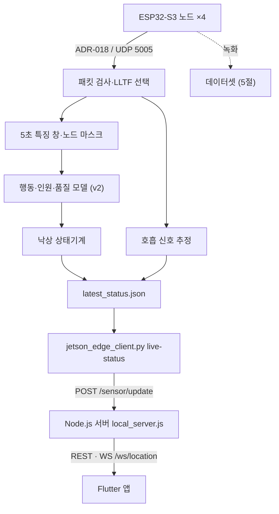

# 센서·엣지·서버 데이터 연결 규격

현재 코드가 실제로 주고받는 형식입니다. 제작설계서의 목표 구조와 다른 부분은 [설계·구현 대조](../IMPLEMENTATION_STATUS.md)에 정리했습니다. 아래 파일의 코드를 바꾸면 이 문서도 함께 고칩니다.

## 1. ADR-018 패킷

현재 수신 파서: [adr018.py](../../edge_ai/hanium_fall_v2/adr018.py). 이 표는 노드 펌웨어(RuView)가 보내는 UDP 패킷을 저장소 파서가 해석하는 규칙이며, ESP-IDF의 원본 CSI 버퍼 형식과는 다릅니다.

| 바이트 오프셋 | 이름 | 형식 | 해석 |
|---|---|---|---|
| 0 | magic | uint32 | `0xC5110001` |
| 4 | node_id | uint8 | 1~255 |
| 5 | antennas | uint8 | 파서 허용 범위 1~4 |
| 6 | subcarriers | uint16 | 원시 복소 값 개수 |
| 8 | frequency_mhz | uint32 | 중심 주파수 MHz |
| 12 | sequence | uint32 | 순번 |
| 16 | rssi_dbm | int8 | RSSI |
| 17 | noise_floor_dbm | int8 | 잡음 바닥 |
| 18 | ppdu | uint8 | LLTF 추출은 `0x00`, `0xFF` 허용 |
| 19 | flags | uint8 | 하위 2비트 대역폭 코드가 0인 20MHz만 허용 |
| 20 이후 | iq | int8 배열 | `(antennas, subcarriers, 2)` |

헤더는 little-endian `<IBBHIIbbBB`, 총 20바이트입니다. 파서는 최소 페이로드 길이를 검사하며 후행 바이트 수를 기록합니다. LLTF 추출 단계는 폭 64·128·192만 허용하고 첫 64개 복소 값을 선택합니다. 앞 2개 값은 항상 0으로 마스킹합니다. 실측 녹화에서는 노드가 보내는 패킷 폭이 수집일마다 달랐습니다([데이터셋 설명서](../../dataset/README.md#사용할-때-주의할-점)).

**펌웨어 확인 항목:** [Espressif 공식 설명](../research/RELATED_WORK.md#1-esp32-s3-csi-버퍼-규격)은 원본 버퍼의 값 순서를 허수→실수로 설명합니다. v2 특징 코드는 마지막 축의 0을 실수, 1을 허수로 해석합니다. RuView 펌웨어가 ADR-018로 직렬화할 때 순서를 바꾸는지는 펌웨어 커밋과 실제 패킷으로 확인할 예정입니다. 순서가 바뀌어도 진폭은 같고 위상차의 부호가 달라지므로, 확인할 때는 위상까지 비교합니다. 진폭만 쓰는 v1 입력은 이 순서의 영향을 받지 않습니다.

## 2. 모델 입력

| 항목 | v1 ([`hanium_fall_v1`](../../edge_ai/hanium_fall_v1/README.md), 개발보고서 모델) | v2 ([`hanium_fall_v2`](../../edge_ai/hanium_fall_v2), 실시간 파이프라인) |
|---|---|---|
| 시간축 | 패킷 500개(약 5초). 4개 노드의 패킷을 도착 순서대로 이어 붙이고, 녹화에서 가장 흔한 폭의 패킷만 사용 | 5초 창을 노드별 수신 시각 기준 32Hz로 보간, 160프레임 |
| 값 | 패킷 오프셋 10부터 2바이트씩 묶은 크기 134개: 헤더 5 + 첫 LLTF 블록 64 + 두 번째 64값 블록 + 1([채널 구성](../../dataset/README.md#134채널의-실제-구성)) | 로그 진폭 64 + 중앙값/MAD 동적 진폭 64 + 시간축 위상차 64 + RSSI 1 = 193 |
| 정규화 | 윈도우 전체 값의 평균·표준편차(z-score). `--channels csi`·`lltf`로 헤더 제외 가능 | 특징마다 척도를 맞추고 범위를 제한: 로그 진폭 `(x−3)/1.5`, 동적 진폭은 서브캐리어별 중앙값/MAD, 위상차 `/π`, RSSI `(x+70)/20` |
| 모델 입력 | `(batch, 134, 500)` | `(batch, 4, 193, 160)` + `node_mask`, `node_quality` |
| 출력 | softmax 2분류, `[:, 0]`이 낙상 확률 | 행동 10종·인원·품질 |

v2 행동 특징의 위상차는 **같은 서브캐리어의 연속 시각 차이**입니다. 호흡 추정기의 인접 서브캐리어 위상차와 구분합니다. 노드 정렬은 `expected_nodes`를 정렬한 순서이며, 누락된 노드는 배열의 고정 슬롯과 마스크로 표현합니다.

근거: [v1 data.py](../../edge_ai/hanium_fall_v1/data.py), [features.py](../../edge_ai/hanium_fall_v2/features.py), [config.py](../../edge_ai/hanium_fall_v2/config.py). 패킷 사이의 긴 공백이 v2 품질 점수에 반영되지 않는 사례는 [패킷 누락 실험](../../experiments/RESULTS.md#3-패킷-누락과-품질-점수)에 있습니다.

## 3. 엣지 상태 JSON

생성: [live_inference.py](../../edge_ai/hanium_fall_v2/live_inference.py), 변환: [jetson_edge_client.py](../../app/server/jetson_edge_client.py).

| 필드 | 의미 | 연결 클라이언트(`live-status`)의 처리 |
|---|---|---|
| `schema` | `hanium.ruview.live-status.v2` | 버전 식별 |
| `unix_time` | 상태 생성 시각 | `--max-age`(기본 10초)보다 오래되었거나 값이 없으면 전달하지 않고 `status: unknown`을 보냄 |
| `activity`, `activity_probabilities` | 행동과 확률 | 화면 자세(`pose`)로 변환. 확률만으로 경보를 결정하지 않음 |
| `fall_model_available` | 모델 사용 가능 여부 | 모델이 없으면 `fall.state`가 `model_unavailable`이 되고 `unknown`으로 전달 |
| `quality`, `node_quality`, `node_mask` | 품질과 사용 노드 | 신호 품질·가용성과 추론 결과를 함께 해석 |
| `fall.state`, `fall.alarm` | 상태기계 판단과 경보 | 경보 참 또는 `confirmed` → `danger`. `normal`·`fall_candidate`·`post_fall_check`·`recovered` → `normal`. `model_unavailable`·`unknown`·미인식 상태 → `unknown` |
| `health.respiratory.breathing_rate_bpm` | 호흡 추정값 또는 null | null이면 `breathingRate`를 보내지 않음 |
| `health.respiratory.breathing_confidence` | 호흡 추정 신뢰도 | 호흡값이 있을 때만 함께 전달 |

## 4. 서버 입력과 앱 표시

`POST /sensor/update`가 상태를 갱신하고, 서버([local_server.js](../../app/server/local_server.js))가 REST와 `WS /ws/location`으로 앱에 전달합니다.

| 필드 | 값 | 처리 |
|---|---|---|
| `x`, `y` | 0~1 | 연결 클라이언트의 `--room-x`, `--room-y`로 지정한 정규화 설치 좌표. 사람의 위치를 추정한 값이 아님 |
| `status` | `normal`, `still`, `out`, `danger`, `unknown` | `fall`·`fallen`·`lying`은 `danger`로 정규화. `model_unavailable`과 인식하지 못한 값은 `unknown`(판단 불가). 누락 시 이전 상태(없으면 `unknown`) |
| `source` | `jetson_orin`(실제 엣지 추론), `scripted_demo`(시연 스크립트 `once`·`sequence`) | 누락 시 서버가 `unknown`으로 저장 |
| `pose` | `standing`, `lying` 등 | 누락 시 상태에서 추정 |
| `holdMs` | 밀리초 | 이 시간 동안 입력값을 유지(기본 60초) |
| `confidence` | 0~1, 선택 | 범위를 벗어나면 잘라 냄 |
| `breathingRate`, `breathingConfidence` | 선택 | 값이 없으면 서버도 채우지 않고 `breathingRate: null`로 전달 |

요청 규칙:

- JSON 본문을 받는 POST는 `Content-Type: application/json`이 아니면 415로 거절합니다.
- 서버를 `HANIUM_API_TOKEN`으로 실행하면 모든 POST와 상태 조회 GET에 `Authorization: Bearer <토큰>`이 필요하고, 없으면 401입니다. 설정하지 않으면 헤더는 필요 없습니다. 대상 경로와 예외(`WS /ws/location` 등)는 [서버 설명서](../../app/server/README.md)에 있습니다.

앱 표시와 공개 범위:

- `unknown`은 알림·푸시를 만들지 않고, 앱에서 '확인 필요'로 표시합니다.
- `breathingRate`가 null이거나 `breathingEstimated: true`이면 앱은 숫자 대신 '측정 대기'로 표시합니다.
- `source: scripted_demo` 입력에는 앱이 '시연 입력' 칩을 붙여 실제 추론(`jetson_orin`)과 구분합니다.
- 위치 공유 OFF(`POST /settings`의 `locationSharingEnabled: false`)는 REST와 WebSocket 모두에 적용됩니다. 좌표를 (0.5, 0.5), 방을 '위치 공유 꺼짐'으로 바꿔 보내고, 새 알림·푸시에는 '위치 비공개'를 기록합니다.

서버 시작·초기화 직후 상태는 `unknown`입니다. 추론 결과가 오래되었는지는 연결 클라이언트(`live-status`)가 판단하며, 연결 클라이언트 자체가 멈추면 서버는 마지막 상태를 그대로 유지합니다([구현 대조](../IMPLEMENTATION_STATUS.md#우선-보완할-구현-항목)).

근거: 회귀 테스트 [app/server/tests](../../app/server/tests), 서버와 연결 클라이언트를 함께 띄운 [연동 검사](../../experiments/RESULTS.md#4-서버-연동과-기존-검사).

## 5. 데이터셋 파일 형식

실측 데이터셋의 파일은 위 형식과 아래처럼 연결됩니다. 필드 전체, 내려받기, 라벨, 주의할 점은 [데이터셋 설명서](../../dataset/README.md#원본-형식)를 기준으로 합니다.

| 파일 | 위 규격과의 관계 |
|---|---|
| `recordings/csi-<epoch>.csi.jsonl` | 패킷 1개 = 1줄. `iq_hex`는 1절 패킷의 오프셋 8(주파수)부터 끝까지이며, 앞 8바이트를 붙이면 `adr018.py`로 그대로 파싱됩니다([`raw_to_v2.py`](../../dataset/tools/raw_to_v2.py)) |
| `ground-truth/keypoints_<KST 시각>.jsonl` | 웹캠 관절 좌표(COCO 17점). CSI와 `ts_ns`(Unix ns)로 시각을 맞추는 정답 기록 |
| `csi134_*.npz` | `X` float32 `(N, 500, 134)`는 2절 v1 입력을 전치하기 전 배열. `window_id`로 [`windows.csv`](../../dataset/metadata/windows.csv)와 연결 |
| `v2_sessions/csi-<epoch>.npz` | 첫 LLTF 64개 `iq` int8 `(N, 1, 64, 2)`와 헤더 필드. [`capture_labeled.py`](../../edge_ai/hanium_fall_v2/capture_labeled.py) 세션과 같은 배열 이름이라 2절 v2 특징 추출에 그대로 입력 |
