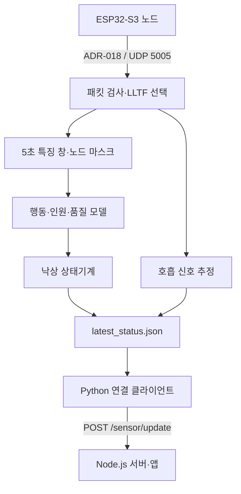

# 센서·엣지·서버 데이터 연결 규격

기준 코드 `b3bc7e4`의 실제 처리 경로를 정리했습니다. 제작설계서의 목표 구조와 구분하며, 변경 시 아래 파일의 코드와 함께 갱신합니다.

## 1. ADR-018 패킷

현재 수신 파서: [adr018.py](../../edge_ai/hanium_fall_v2/adr018.py). 이 표는 저장소 파서의 계약이며, ESP-IDF의 원본 CSI 버퍼와 같은 형식이라는 의미는 아닙니다.

| 바이트 오프셋 | 이름 | 형식 | 해석 |
|---|---|---|---|
| 0 | magic | uint32 | `0xC5110001` |
| 4 | node_id | uint8 | 1~255 |
| 5 | antennas | uint8 | 파서 허용 범위 1~4 |
| 6 | subcarriers | uint16 | 원시 복소 값 개수 |
| 8 | frequency_mhz | uint32 | 중심 주파수 MHz |
| 12 | sequence | uint32 | 순번 |
| 16 | rssi_dbm | int8 | RSSI |
| 17 | noise_floor_dbm | int8 | 잡음 바닥 |
| 18 | ppdu | uint8 | LLTF 추출은 `0x00`, `0xFF` 허용 |
| 19 | flags | uint8 | 하위 2비트 대역폭 코드가 0인 20MHz만 허용 |
| 20 이후 | iq | int8 배열 | `(antennas, subcarriers, 2)` |

헤더는 little-endian `<IBBHIIbbBB`, 총 20바이트입니다. 파서는 최소 페이로드 길이를 검사하며 후행 바이트 수를 기록합니다. LLTF 추출 단계는 폭 64·128·192만 허용하고 첫 64개 복소 값을 선택합니다. 앞 2개 값은 항상 0으로 마스킹합니다.

**펌웨어 확인 항목:** [Espressif 공식 설명](../research/RELATED_WORK.md#1-esp32-s3-csi-버퍼-규격)은 원본 버퍼의 값 순서를 허수→실수로 설명합니다. 현재 Python 특징 코드는 마지막 축의 0을 실수, 1을 허수로 해석합니다. 펌웨어의 ADR-018 직렬화 단계에서 순서를 바꾸는지 실제 펌웨어 커밋과 패킷으로 확인해야 합니다. 펌웨어가 이 저장소에 없으므로 이번 검토만으로 오류 여부를 단정하지 않습니다. 진폭만 맞는지 확인하는 검사는 위상 부호 문제를 놓칠 수 있습니다.

## 2. 모델 입력

| 항목 | 기본값 |
|---|---|
| 시간 창 | 5초 |
| 보간률 | 32Hz, 160프레임 |
| 특징 | 로그 진폭 64 + 중앙값/MAD 동적 진폭 64 + 시간축 위상차 64 + RSSI 1 |
| 노드별 배열 | `(193, 160)` |
| 모델 입력 | `(batch, 4, 193, 160)` |
| 보조 입력 | `node_mask`, `node_quality` |

행동 특징의 위상차는 **같은 서브캐리어의 연속 시각 차이**입니다. 호흡 추정기의 인접 서브캐리어 위상차와 구분합니다. 노드 정렬은 `expected_nodes`를 정렬한 순서이며, 누락된 노드는 배열의 고정 슬롯과 마스크로 표현합니다.

근거: [features.py](../../edge_ai/hanium_fall_v2/features.py), [config.py](../../edge_ai/hanium_fall_v2/config.py). 내부의 긴 패킷 공백이 품질 점수에 반영되지 않는 사례는 [패킷 누락 실험](../../experiments/RESULTS.md#3-패킷-누락과-품질-점수)에 있습니다.

## 3. 엣지 상태 JSON

생성: [live_inference.py](../../edge_ai/hanium_fall_v2/live_inference.py), 변환: [jetson_edge_client.py](../../app/server/jetson_edge_client.py).

| 필드 | 의미 | 연결 시 주의점 |
|---|---|---|
| `schema` | `hanium.ruview.live-status.v2` | 버전 식별 |
| `unix_time` | 상태 생성 시각 | 수신 시각과 구분. 현재 연결 클라이언트는 나이 검사를 하지 않음 |
| `activity`, `activity_probabilities` | 행동과 확률 | 확률만으로 최종 경보를 결정하지 않음 |
| `fall_model_available` | 모델 사용 가능 여부 | 낙상 모델이 없을 때 정상 판단으로 해석하지 않아야 함 |
| `quality`, `node_quality`, `node_mask` | 품질과 사용 노드 | 신호 품질·가용성과 추론 결과를 함께 해석 |
| `fall.state`, `fall.alarm` | 상태기계 판단과 경보 | 경보 참 또는 상태 `confirmed`면 현재 연결 클라이언트가 위험으로 전달 |
| `health.respiratory.breathing_rate_bpm` | 호흡 추정값 또는 null | 값 부재와 실제 측정 0을 혼동하지 않음 |
| `health.respiratory.breathing_confidence` | 호흡 추정 신뢰도 | 값의 존재 여부만으로 신뢰성을 판단하지 않음 |

## 4. 서버 입력과 앱 표시

서버 입력은 `x`, `y`, `status`, `pose`, `source`, `holdMs`와 선택적인 `confidence`, `breathingRate`, `breathingConfidence`입니다. `x`, `y`는 연결 클라이언트의 `--room-x`, `--room-y`로 지정하는 정규화 설치 좌표입니다. 사람의 위치를 자동 추정한 값이 아닙니다.

`POST /sensor/update`가 상태를 갱신하고 `WS /ws/location`으로 앱에 전달합니다. 확정 경보 외 입력은 현재 연결 클라이언트에서 정상으로 매핑됩니다. 서버는 호흡 누락값을 시연값으로 보충할 수 있고 `REAL_SENSOR_ONLY=true`만으로 이 동작이 없어지지 않습니다. [로컬 연동 실험](../../experiments/RESULTS.md#4-서버-연동과-기존-검사)에 실제 관측값을 기록했습니다.

운영 경로를 보완할 때는 모델 없음·판단 불가·입력 만료·예시값의 출처가 엣지에서 화면까지 보존되도록 계약을 먼저 정해야 합니다.
