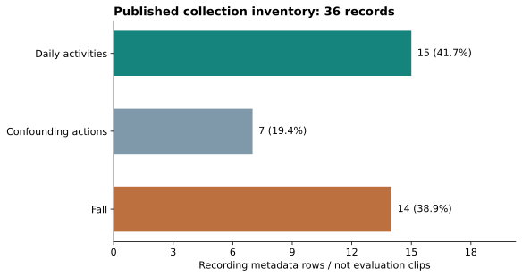

# 공개 수집 기록의 구성과 평가 준비도

대상은 기존 [collection_log.csv](collection_log.csv)의 녹화 목록입니다. 전체 프로젝트 데이터의 규모나 학습·평가 클립 수를 뜻하지 않습니다. 2026-10-18에 목록을 다시 집계했으며, 원본 CSI·관절 좌표·영상은 이번 분석에서 열지 않았습니다.

## 구성

| 동작 구분 | 녹화 기록 수 | 목록 내 비율 |
|---|---:|---:|
| 낙상 | 14 | 38.9% |
| 혼동 동작 | 7 | 19.4% |
| 일상 동작 | 15 | 41.7% |
| 합계 | 36 | 100.0% |



낙상 이외에 비틀거림·물건 줍기·눕기 등 혼동 동작이 포함된 점은 평가 구성에 유용합니다. 다만 녹화별 길이가 없어 이 비율을 시간·프레임·모델 입력 창의 비율로 사용하면 안 됩니다. 정상 생활에서 발생하는 낙상의 실제 빈도를 나타내는 분포도 아닙니다.

## 메타데이터 검사

| 항목 | 집계 결과 | 해석 |
|---|---|---|
| 수집 차수 | 4개 | 서로 다른 사람·장소가 4개라는 의미는 아님 |
| 참여자 ID 기재 | 13건 기재, 23건 미기재 | 공개 목록만으로 전체 피험자 분리를 확인하기 어려움 |
| 키포인트 짝 파일명 | 35건 기재 | 실제 파일 존재·내용·프레임 대응까지 검증한 것은 아님 |
| 파일명 시각 차이 | 키포인트 시작이 CSI보다 1~5초 늦음, 중앙값 3초 | 파일 시작 시각 차이이며 실제 라벨 정렬 오차가 아님 |
| CSI 파일명 중복 | 0건 | 원본 파일 내용 중복 여부는 미확인 |
| CSI epoch와 CSV의 KST 표기 불일치 | 0건 | 파일명과 기록 시각의 일관성만 확인 |

공개 산출물은 집계값만 포함합니다. 참여자별 통계, 개별 녹화 파일명, 행별 시각은 새로 내보내지 않습니다.

## 평가 전에 보완할 사항

1. **녹화 → 클립 → 모델 입력 창의 연결:** 현재 목록 36건과 개발보고서의 1,019개 평가 클립은 단위가 다릅니다. 클립의 원본·구간·해시·분할을 연결하는 목록이 필요합니다.
2. **참여자·공간별 분할 근거:** 미기재 항목을 임의의 서로 다른 사람으로 취급하지 않습니다. 익명 ID를 확인하지 못하면 피험자 독립 평가로 설명할 수 없습니다.
3. **복합 동작의 구간 라벨:** `sit_down / stand_up` 같은 값은 한 녹화에 복수 동작이 있다는 설명입니다. 단일 모델 클래스 이름으로 사용하지 않고 시간 구간별 정답으로 나눠야 합니다.
4. **데이터 누수 방지:** 같은 녹화와 겹치는 입력 창이 학습·검증·시험에 섞이지 않도록 그룹을 먼저 분리합니다. 시험 세트로 임계값을 조정하지 않습니다.
5. **연속 운용 검증:** 동작별 분류 성능 외에 정상 관찰 시간과 오경보 건수, 누락·복구 상황, 전체 알림 지연을 기록합니다.

현재 모델의 10종 라벨은 [labels.py](../../edge_ai/hanium_fall_v2/labels.py)를 따릅니다. 보고서의 11종 동작과 현재 라벨을 연결하는 규칙도 함께 확인해야 합니다. 이 목록 분석만으로 낙상 재현율이나 실환경 성능을 계산하지 않습니다.

## 재현 방법

저장소 루트에서 실행합니다. 분석 코드는 기존 목록을 읽고 전체 집계만 생성합니다.

```bash
python -m pip install -r experiments/requirements.txt
python experiments/audit_collection.py --output experiments/results/local/collection
```

[분석 코드](../../experiments/audit_collection.py) · [게시된 집계 JSON](../../experiments/results/2026-10-18/collection/collection_summary.json)

JSON에는 원본 목록과 분석 코드의 SHA-256을 기록했습니다. 다른 파일로 바뀐 목록을 분석하면 이 문서의 수치와도 다시 대조해야 합니다. 다음 검증의 구체적인 절차는 [실환경 평가 안내](../validation/EVALUATION_PROTOCOL.md)에 있습니다.
