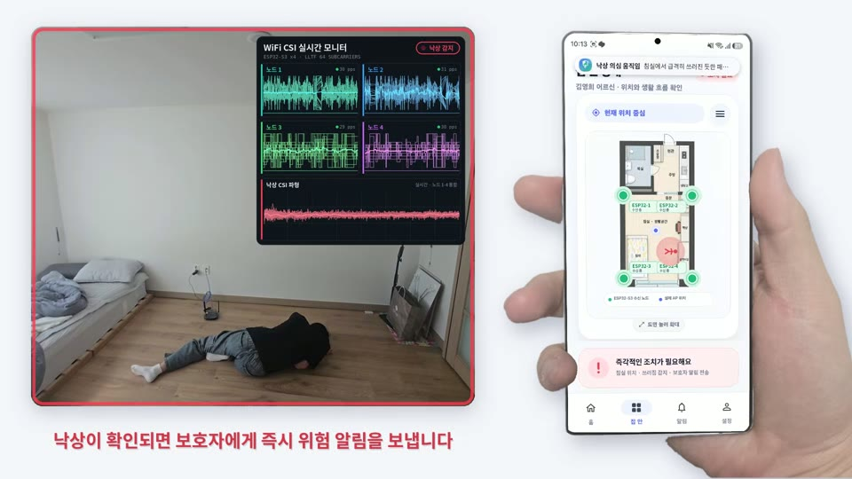

# 최종 결과물

2026 한이음 드림업 공모전 본선 발표와 최종 제출에 사용한 자료입니다. 이 프로젝트는 **동상(한국정보방송통신대연합회장상)**을 받았습니다.

| 자료 | 파일 | 내용 |
|---|---|---|
| 발표자료 | [presentation.pdf](presentation.pdf) | 본선 발표 슬라이드 16쪽: 문제점·필요성, 솔루션 개요, 기대효과, 하드웨어·앱·구현 과정, 성과와 시연 |
| 결과보고서 | [final_report_26_HS022.pdf](final_report_26_HS022.pdf) | 한이음 드림업 결과보고서 양식으로 작성한 최종 보고서 25쪽 |
| 시연 영상 | [demo.mp4](demo.mp4) | 본선 발표에서 상영한 전체 흐름 시연 영상(1분 42초, 무음) |

## 시연 영상 구성

| 순서 | 장면 |
|---|---|
| 1 | 집 네 모서리의 수신 노드 4대가 공유기 신호를 실시간 수신 |
| 2 | 빈 방의 신호를 기준값으로 저장 |
| 3 | 잠든 동안 WiFi 신호로 호흡 상태 확인 |
| 4 | 일상 움직임은 정상 상태로 표시 |
| 5 | 낙상 순간 CSI 파형이 크게 흔들리고, 낙상이 확인되면 보호자에게 위험 알림 |
| 6 | 먼저 본인에게 응답을 요청하고, 응답이 없으면 보호자가 앱에서 바로 전화 |

영상 속 전화 화면의 이름과 번호는 가려져 있습니다.

## 성과

| 구분 | 내용 |
|---|---|
| 공모전 | 2026 한이음 드림업 공모전 동상 (한국정보방송통신대연합회장상) |
| 논문 | 「Wi-Fi 수신 링크별 보정을 이용한 실내 위치 판별 방법의 수치 평가」, 한국정보처리학회 ACK 2026 추계학술발표대회, 구두 발표(2026.11.07) |
