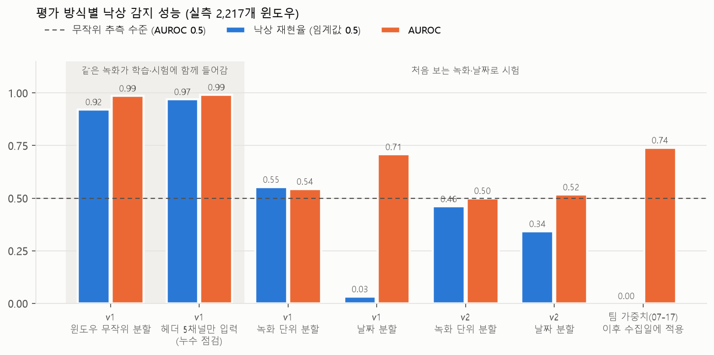

# 실측 데이터 검증 결과

팀이 직접 수집한 [CSI 데이터셋](../dataset/README.md) 2,217개 윈도우로 낙상 감지 모델을 다시 학습·평가했습니다. 같은 데이터를 세 가지 방식으로 나누어 평가해, 개발보고서 수치가 어떤 조건에서 나오는지와 실제 설치 환경에서 기대할 수 있는 성능을 구분했습니다.

<p align="center"></p>

## 요약

1. **개발보고서 수치는 같은 조건에서 다시 얻어집니다.** 보고서와 같은 1,019개 윈도우를 무작위 80/20으로 나누면(보고서에 분할 방식이 적혀 있지 않아 추정) 낙상 재현율 0.997, 비틀거리기(넘어지지 않음) 오탐 0건입니다. 보고서는 재현율 0.933, 비틀거리기 오탐 0건이었습니다.
2. **그 점수에는 녹화를 알아보는 효과가 섞여 있습니다.** CSI가 아닌 패킷 헤더 5채널만 넣어도 재현율 0.970이 나옵니다. 같은 녹화의 이웃 구간이 학습·시험에 함께 들어가므로, 모델이 동작보다 "어느 녹화인지"를 알아맞힐 수 있습니다.
3. **처음 보는 녹화·다른 날에는 아직 일반화되지 않습니다.** v1은 녹화 단위로 나누면 AUROC 0.544, 날짜로 나누면 재현율 0.033입니다. 실시간용 v2는 학습 데이터에서는 AUROC 0.890(겹 평균)까지 맞추지만 처음 보는 녹화에서는 0.500입니다. 07-17 팀 가중치는 이후 수집일의 낙상 359개를 하나도 찾지 못했습니다.
4. **원인은 모델 구조보다 학습 데이터에 있다고 판단합니다.** 두 모델 모두 학습 데이터에는 맞지만 다른 녹화로 옮겨가지 않습니다. 라벨이 녹화 단위이고, 노드가 보내는 패킷 형식이 섞이며, 동작에 따른 CSI 변화가 다른 변동보다 작습니다(5절). 다음 수집은 이 세 가지를 고치도록 설계합니다(6절).

## 평가 방법

| 항목 | 내용 |
|---|---|
| 데이터 | [`dataset/metadata/windows.csv`](../dataset/metadata/windows.csv)의 500패킷 윈도우 2,217개(중앙값 5.0초), 녹화 45건, 낙상 969개 |
| 라벨 | 녹화 단위 라벨에서 낙상(`fall`) = 1, 나머지 14종 = 0 |
| 분할 | **윈도우 무작위**: 라벨별 층화 80/20 · **녹화 단위**: 녹화 45건을 5겹으로 나눠 같은 녹화가 학습·시험에 동시에 들어가지 않음 · **날짜 단위**: 07-08~07-15로 학습, 07-24·07-28(새 참여자 S2 포함)로 시험 |
| v1 | `CSI1DCNN`, 134채널 × 500패킷, 윈도우 z-score, 가중 교차 엔트로피, Adam(1e-3) + cosine, 25 epoch, 배치 32 |
| v2 | 노드별 LLTF 64개 → 193채널 × 160프레임(윈도우 시작부터 5초), `MultiNodeFallModel`, 행동 10종 + 인원 + 품질 손실, AdamW(1e-3) + cosine, 60 epoch, 기울기 크기 제한 5, 학습 데이터 증강. 낙상 확률 = 행동 10종 softmax 중 낙상 |
| 판정 | 낙상 확률 ≥ 0.5. 확률 순위만 보는 AUROC(0.5 = 무작위 추측)를 함께 보고 |
| 환경 | CPU, PyTorch 2.14, 시드 고정(v1은 결정적 연산 설정). 반복 실험은 평균 ± 표준편차, 검출 수·정밀도는 반복 합산 |

## 결과

| 모델 | 평가 방식 | 반복 | 낙상 재현율 | 정밀도(합산) | AUROC | 낙상 검출 / 전체 | 오경보 |
|---|---|---|---:|---:|---:|---:|---:|
| v1 | 개발보고서 조건 추정: 07-08·07-09 1,019개, 윈도우 무작위 80/20 | 5회 | 0.997 ± 0.007 | 0.990 | 1.000 | 299 / 300 | 3 |
| v1 | 2,217개 전체, 윈도우 무작위 80/20 | 5회 | 0.922 ± 0.014 | 0.953 | 0.986 ± 0.004 | 894 / 970 | 44 |
| v1 | 같은 분할, CSI가 아닌 헤더 5채널만 입력 | 5회 | 0.970 ± 0.011 | 0.918 | 0.992 ± 0.003 | 941 / 970 | 84 |
| v1 | 1,019개, 녹화 단위 5겹 | 5겹 | 0.367 ± 0.334 | 0.324 | 0.547 ± 0.392 | 115 / 302 | 240 |
| v1 | 2,217개, 녹화 단위 5겹 | 5겹 | 0.553 ± 0.117 | 0.480 | 0.544 ± 0.130 | 544 / 969 | 590 |
| v1 | 2,217개, 녹화 단위 5겹, LLTF 64채널만 | 5겹 | 0.403 ± 0.208 | 0.373 | 0.436 ± 0.118 | 399 / 969 | 672 |
| v1 | 날짜 분할 (07-08~07-15 학습 → 07-24·07-28 시험) | 3회 | 0.033 ± 0.046 | 1.000 | 0.708 ± 0.025 | 35 / 1077 | 0 |
| v1 | 날짜 분할, 헤더 제외 | 3회 | 0.012 ± 0.015 | 0.464 | 0.530 ± 0.020 | 13 / 1077 | 15 |
| v1 | 날짜 분할, LLTF 64채널만 | 3회 | 0.061 ± 0.039 | 0.629 | 0.494 ± 0.015 | 66 / 1077 | 39 |
| v2 | 2,217개, 녹화 단위 5겹 | 5겹 | 0.461 ± 0.052 | 0.418 | 0.500 ± 0.096 | 442 / 969 | 616 |
| v2 | 날짜 분할 | 3회 | 0.343 ± 0.196 | 0.462 | 0.517 ± 0.010 | 369 / 1077 | 430 |
| 팀 가중치 `team_v1_0717` | 07-24·07-28 합쳐서 적용 (만든 뒤 수집) | - | 0.000 | - | 0.740 | 0 / 359 | 0 |
| 팀 가중치 `team_v1_0717` | b1_0708_0709 전체에 적용 | - | 0.834 | 0.996 | 0.999 | 252 / 302 | 1 |
| 팀 가중치 `team_v1_0717` | b2_0715 전체에 적용 | - | 0.666 | 1.000 | 0.998 | 205 / 308 | 0 |
| 팀 가중치 `team_v1_0717` | b3_0724 전체에 적용 | - | 0.000 | - | 0.787 | 0 / 203 | 0 |
| 팀 가중치 `team_v1_0717` | b4_0728 전체에 적용 | - | 0.000 | - | 0.720 | 0 / 156 | 0 |
| 팀 가중치 `team_v1_0803` | b1_0708_0709 전체에 적용 | - | 0.133 | 0.156 | 0.335 | 40 / 302 | 217 |
| 팀 가중치 `team_v1_0803` | b2_0715 전체에 적용 | - | 0.162 | 1.000 | 0.721 | 50 / 308 | 0 |
| 팀 가중치 `team_v1_0803` | b3_0724 전체에 적용 | - | 0.763 | 1.000 | 0.889 | 155 / 203 | 0 |
| 팀 가중치 `team_v1_0803` | b4_0728 전체에 적용 | - | 0.000 | - | 0.756 | 0 / 156 | 0 |

`team_v1_0717.pth`는 07-24·07-28 데이터가 만들어지기 전 파일이므로 07-24·07-28 행이 처음 보는 데이터에 대한 결과이고, b1·b2 행에는 학습에 쓰인 데이터가 들어 있습니다. `team_v1_0803.pth`는 학습 데이터·전처리 기록이 남아 있지 않아 어느 행이 학습 데이터인지 확인할 수 없으며, b1에서 AUROC가 무작위보다 낮은(0.335) 원인도 확인하지 못했습니다.

## 1. 개발보고서 수치의 확인

보고서 4.4절과 6.2절의 1,019개 윈도우(07-08·07-09, 11종 동작, 낙상 302개)를 라벨별 층화로 80/20 나누어 5번 반복하면, 시험 낙상 300개 중 299개를 찾고 비틀거리기 윈도우 55개(5회 합계)는 한 번도 낙상으로 판정하지 않습니다. 보고서의 재현율 0.933과 비틀거리기 오탐 0건은 이와 같은 분할 방식에서 나온 값으로 판단됩니다. 이 재실험은 보고서의 공개 데이터 선행 학습 없이 실측 데이터만으로 처음부터 학습했습니다.

## 2. 무작위 분할이 높게 나오는 이유

- 134채널 중 0~4번은 CSI가 아니라 패킷 헤더 값(주파수, 패킷 순번, RSSI·잡음, 플래그)입니다. 이 5채널만 입력해도 재현율 0.970, AUROC 0.992가 나옵니다. 패킷 순번과 RSSI는 녹화마다 다르므로 녹화를 구분하는 단서가 됩니다.
- 라벨이 녹화 단위라 녹화를 알아보면 라벨도 맞힐 수 있습니다. 같은 녹화의 연속된 구간이 학습과 시험에 나뉘어 들어가면 이 지름길이 열립니다.
- 녹화를 통째로 시험에 두면 AUROC가 0.544로 떨어집니다. 1,019개 세트만 써도 0.547입니다.

## 3. 다른 날의 데이터

- 07-17 팀 가중치를 07-24·07-28(낙상 359개)에 적용하면 하나도 찾지 못합니다. 확률 순위(AUROC 0.740)는 남아 있지만 낙상 확률이 대부분 0.5 아래로 내려갑니다.
- 07-24부터는 노드가 보내는 패킷 폭이 대부분 198(복소 값 192개)로 바뀌어, 134채널 중 69~133번의 의미가 달라집니다([채널 구성](../dataset/README.md#134채널의-실제-구성)). 헤더를 빼거나(`csi`) 의미가 같은 LLTF 64개만 써도(`lltf`) 날짜 분할 AUROC는 0.530·0.494입니다.
- 07-24에는 노드 1의 수신이 줄어 500패킷 윈도우의 실제 길이가 중앙값 약 7.5초로 늘었습니다(다른 날은 약 4.5~5초). 날짜 사이의 이런 차이도 실패와 함께 나타나지만, 시간 축을 32Hz로 고정한 v2도 일반화되지 않았으므로 단독 원인으로 보지는 않습니다.

## 4. v2 파이프라인으로 같은 평가

실시간 서비스용 v2(노드별 분리, LLTF 고정 선택, 32Hz 보간, 노드 attention 융합)를 같은 윈도우 시작 시각·라벨·분할로 학습했습니다([`v2_measured.py`](v2_measured.py)). 원본 녹화를 v2 세션 형식으로 바꾸는 과정은 [`raw_to_v2.py`](../dataset/tools/raw_to_v2.py)에 있습니다.

| v2 평가 | 시험 낙상 재현율 | 시험 AUROC | 학습 데이터 재현율 | 학습 데이터 AUROC |
|---|---:|---:|---:|---:|
| 녹화 단위 5겹 | 0.461 | 0.500 | 0.828 | 0.890 |
| 날짜 분할, 3회 | 0.343 | 0.517 | 0.968 | 0.964 |

v2는 대부분의 겹에서 학습 데이터에 잘 맞지만, 처음 보는 녹화·날짜에서는 확률 순위가 무작위 추측 수준에 머뭅니다. 입력 처리와 모델 구조를 바꿔도 결과가 같으므로, 병목은 모델 구조가 아니라 학습 데이터라고 판단합니다. 겹별 값은 [`runs.json`](results/v2_measured/recording/runs.json)에 있습니다.

## 5. 신호 진단: CSI가 동작을 얼마나 담고 있나

모델 없이 계산한 움직임 지표(노드별 첫 LLTF 블록의 로그 진폭에서 패킷별 이득 변화를 빼고, 5초 동안의 서브캐리어별 표준편차를 평균)로 "움직이는 동작(걷기·낙상 등)"과 "정지 동작(앉아 있기·서 있기·누워 있기)"을 얼마나 구분하는지 보았습니다([`signal_diagnostics.py`](signal_diagnostics.py), [결과 JSON](results/diagnostics/motion_signal.json)).

| 사용한 패킷 | 움직임 vs 정지 AUROC | 낙상 vs 나머지 AUROC |
|---|---:|---:|
| 모든 폭 | 0.601 | 0.503 |
| 복소 값 128개(녹화 폭 134)만 | 0.514 | 0.433 |
| 복소 값 192개(녹화 폭 198)만 | 0.728 | 0.713 |

- 모든 패킷을 섞으면 앉아 있는 녹화와 걷는 녹화의 CSI 변화량이 거의 같습니다. 동작에 따른 변화보다 다른 변동(패킷 종류별 이득 차이, 노드 배치 변화 등)이 더 큽니다.
- 192값 패킷만 쓰면 지표 하나로도 구분 정도가 올라갑니다. 다만 이 표는 모든 날짜를 보고 만든 진단이고 학습 모델로 검증하지 않았으므로, 패킷 형식을 하나로 고정한 새 수집 데이터로 확인합니다.

## 6. 다음 단계

1. **펌웨어·공유기 설정 고정** : 노드가 한 가지 PPDU 형식(폭)의 패킷만 보내도록 설정하고, 수집 시작 전에 노드별 패킷 폭·수신량을 [`validate_multinode_stream.py`](../edge_ai/hanium_fall_v2/validate_multinode_stream.py)로 확인합니다.
2. **사건 단위 라벨** : 5분 녹화 전체에 같은 라벨을 붙이지 않고, 웹캠 관절 좌표로 넘어지는 순간을 찾아 그 전후 구간만 `fall`로 둡니다. [`pose_events.py`](../dataset/tools/pose_events.py)의 몸통 하강 지표가 출발점입니다. v2 수집 도구 [`capture_labeled.py`](../edge_ai/hanium_fall_v2/capture_labeled.py)는 이미 사건 시각을 기록합니다.
3. **빈 방·정지 기준선** : 사람이 없는 방과 가만히 있는 사람의 기록을 함께 모아 움직임이 없을 때의 CSI 변동 범위를 정합니다.
4. **평가 기준** : 모든 수치는 녹화 단위 이상으로 나누어 보고하고, 무작위 분할 결과는 비교용으로만 씁니다.

## 재현

```bash
python dataset/tools/download.py --v2                     # 학습 윈도우 + v2 세션 (약 345MB)
python experiments/run_v1_experiments.py --jobs 2 --threads 2   # v1 전체 (CPU 약 30분)
python experiments/v2_measured.py --protocol recording --threads 2 --out experiments/results/v2_measured/recording
python experiments/v2_measured.py --protocol temporal --seeds 0 1 2 --threads 2 --out experiments/results/v2_measured/temporal
python experiments/signal_diagnostics.py
python experiments/make_results_table.py                  # 위 결과 표
python experiments/plot_figures.py                        # 그림
```

v2의 한 겹은 CPU 2스레드에서 약 15분 걸립니다. `--fold-index`로 겹을 나눠 여러 프로세스에서 돌리고 `--merge`로 합칠 수 있습니다. 공개한 v1 결과는 `--threads 2`로 다시 만든 것이며, 스레드 수가 다르면 소수 셋째 자리에서 차이가 날 수 있습니다.

결과 폴더마다 `summary.json`(평균·표준편차·실행 환경), `runs.json`(반복별 지표·동작별 낙상 판정 비율·학습 손실), `predictions.csv`(윈도우별 낙상 확률)가 있습니다.
