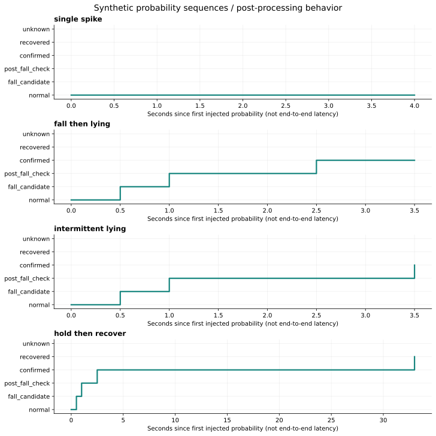
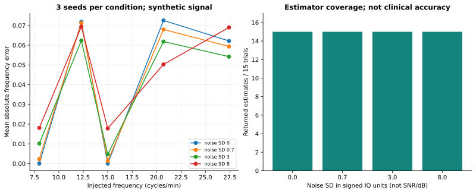
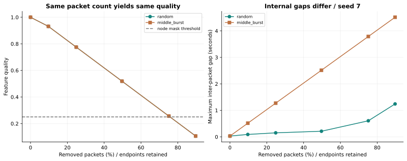

# 소프트웨어 실험 결과 — 2026-10-18

기준 코드는 문서 PR #1이 병합된 `b3bc7e4`입니다. 실제 실행 환경·설정·입력 파일 해시는 [environment.json](results/2026-10-18/environment.json), 실행 방법은 [실험 안내](README.md)에 있습니다. 아래 결과는 센서·학습 가중치 없이 얻은 소프트웨어 검증 자료입니다.

## 1. 낙상 판정 시나리오

0.5초마다 사람이 정한 행동 확률을 상태기계에 넣었습니다. 기본 확률은 지정 행동 0.9, `other_motion` 0.1이며, 저품질·빈 방 시나리오만 품질·인원 조건을 변경했습니다. 모델 추론을 통과한 입력이 아닙니다.

| 시나리오 | 관측 결과 |
|---|---|
| 평상시 / 한 번만 높은 낙상 확률 | 경보 없음 |
| 낙상 확률 누적 후 눕기 | 최초 입력 후 2.5초에 `confirmed` |
| 확정 전 다시 서기 | 경보 없이 `recovered` |
| 눕기·회복 근거 없이 제한 시간 경과 | `normal`로 복귀 |
| 낮은 품질 | `unknown` |
| 확정 후 빈 방 예측 / 품질 저하 | 확정 경보 유지 |
| 눕기 사이에 다른 행동 삽입 | 누적 3회가 되면 3.5초에 확정 |
| 확정 후 계속 서기 | 최초 입력 후 33.0초에 회복, 경보 확정 시점으로부터 30.5초 |

10개 시나리오 모두 지정한 기대 결과와 일치했습니다. **2.5초는 주입한 확률을 처리한 시간**입니다. CSI 수집·5초 입력 창·모델 계산·통신·앱 표시를 포함한 감지 지연으로 사용하면 안 됩니다. 눕기 판정은 연속 3회가 아니라 누적 3회이므로, 실제 데이터에서 간헐적인 높은 눕기 확률이 미치는 영향을 따로 평가해야 합니다.

[입력 시나리오](fall_scenarios.json) · [단계별 전체 기록](results/2026-10-18/fall_trace.csv)

## 2. 합성 호흡 주파수 추정

32Hz·61초, 64개 복소 값 중 앞 2개를 0으로 가린 signed int8 배열을 생성했습니다. 각 성분은 `real=35+7·sin(2πft+phase)+noise`, `imag=8+2·sin(2πft+phase)+noise`이며, `phase=0.02×서브캐리어 인덱스`입니다. 실수·허수 잡음은 독립 정규분포입니다. 주파수는 8.0·12.3·15.0·20.7·27.4회/분을 사용해 FFT 정수 bin과 비정수 bin을 함께 포함했습니다.

| 잡음 표준편차(IQ 정수값 단위) | 시행 수 / 추정 반환 | 평균 절대 오차(회/분) | 최대 절대 오차(회/분) |
|---|---|---|---|
| 0.0 | 15 / 15 | 0.0413 | 0.0726 |
| 0.7 | 15 / 15 | 0.0404 | 0.0719 |
| 3.0 | 15 / 15 | 0.0386 | 0.0839 |
| 8.0 | 15 / 15 | 0.0449 | 0.0862 |

각 수준은 주파수 5개와 시드 3개의 조합입니다. 잡음 0인 시드 3회는 동일 입력이므로 독립적인 증거를 늘리지 않습니다. 오차는 반환된 추정값만으로 계산하며 이번에는 60회 모두 값이 반환됐습니다. 작은 오차는 **고정 주파수 사인파의 복원 결과**입니다. 다중경로, 비정상 호흡, 사람 움직임, 공간 차이, 실제 기준 장치와의 오차는 포함하지 않았습니다. 잡음 표준편차를 SNR 또는 dB로 해석하지 않습니다.

영 신호·상수 신호·20초 이력·3초 오래된 입력에서는 추정값이 없었습니다. 반면 **백색잡음만 넣어도 단일 노드 추정기는 약 24.65회/분을 반환**했으며 신뢰도는 약 0.200이었습니다. 이는 기본 신뢰도 기준 0.45보다 낮습니다. 값이 존재하는지만 검사해서는 안 되고, 운영 경로의 다중 노드·신뢰도·움직임 조건을 함께 적용해야 합니다. 이번 실험은 단일 노드 추정기 평가이며 전체 `RespiratoryMonitor`의 실측 성능 검증은 아닙니다.

[60회 원시 결과](results/2026-10-18/respiration_trials.csv) · [불충분 입력 관측](results/2026-10-18/respiration_probes.json)

## 3. 패킷 누락과 품질 점수

5초에 약 33pps인 165개 타임스탬프에서 패킷을 제거했습니다. 누락률은 0·10·25·50·75·90%, 패턴은 무작위 제거와 중앙 연속 구간 제거, 시드는 3개입니다. 양 끝 패킷을 유지해 시간 범위와 패킷 개수가 같은 경우를 비교했습니다. 36회 모두 유한한 특징 배열을 생성했습니다.

| 약 50% 누락, 시드 7 | 남은 패킷 | 최대 패킷 간격 | 품질 점수 |
|---|---|---|---|
| 무작위 누락 | 83 | 0.212초 | 0.51875 |
| 중앙 연속 누락 | 83 | 2.515초 | 0.51875 |

현재 품질은 `시간 범위 커버리지 × 패킷 밀도`로 계산되어 내부의 긴 공백을 직접 반영하지 않습니다. 두 경우 모두 노드 마스크 기준 0.25를 넘지만, 후자의 보간 구간은 훨씬 깁니다. **마스크 통과가 신호의 연속성이나 모델 정확도를 보장하지 않습니다.** 최대 공백 또는 구간별 커버리지를 품질 지표에 추가할지 후속 검토가 필요합니다. 무작위 패턴의 세부 간격은 시드에 따라 달라지며 그림에는 시드 7을 표시했습니다. 연속 누락은 시드에 무관합니다.

노드를 0·1·2·4개 제공한 경우 텐서 크기는 모두 `(4, 193, 160)`이었고 존재하는 노드만 마스크에 반영됐습니다. 이는 입력 구성 검사이며, 노드가 빠졌을 때 학습 모델의 정확도가 유지된다는 실험은 아닙니다.

[36회 원시 결과](results/2026-10-18/packet_loss_trials.csv) · [노드 마스크 결과](results/2026-10-18/node_mask_results.json)

## 4. 서버 연동과 기존 검사

임시 Node.js 서버와 Python 연결 클라이언트에 합성 JSON을 전달했습니다. 서버 사본의 수신 주소만 loopback으로 제한했으며 Firebase 설정이나 실제 사용자 상태는 사용하지 않았습니다.

| 관측 항목 | 결과 |
|---|---|
| 확정 경보 입력 | `danger` 전달 |
| 호흡값 18.2 입력 | 18.2 유지, `breathingEstimated=false` |
| 모델 미설치 입력 | `normal`로 전달되는 문제 재현 |
| 호흡값 누락 | 연결 클라이언트는 생략하지만 서버가 16.8을 보충, 예시값 플래그 참 |
| `unix_time=1`인 오래된 상태 | 전송이 수락되는 문제 재현 |

숫자 18.2도 실측값이 아닌 주입한 예시값입니다. 플래그 전달은 확인했지만 Flutter 화면과 FCM 단말 수신은 이번 실험에 포함하지 않았습니다. 알려진 문제의 재현은 배포 기준 통과와 구분합니다.

기존 단위 테스트는 31개 중 **25개 통과·6개 건너뜀**입니다. PyTorch 관련 항목을 실행하지 않았으며, 자체 점검도 `TORCH_MODELS=SKIPPED`를 기록했습니다. 원래 테스트의 건너뜀 사유에 적힌 “Jetson에서 검사” 문구는 테스트 코드의 문자열일 뿐, 이번에 Jetson 검사를 했다는 뜻이 아닙니다.

[서버 관측 JSON](results/2026-10-18/server_bridge.json) · [테스트 전체 로그](results/2026-10-18/unit_tests.txt) · [자체 점검 로그](results/2026-10-18/selftest.txt)

## 후속 실험에 필요한 자료

현재 가중치·평가 분할·원본 CSI·기준 호흡값·단말 알림 수신 기록이 준비되면 [실환경 평가 절차](../docs/validation/EVALUATION_PROTOCOL.md)를 적용합니다. 합성 신호 오차를 학습 모델의 실환경 성능으로 사용하지 않습니다.
